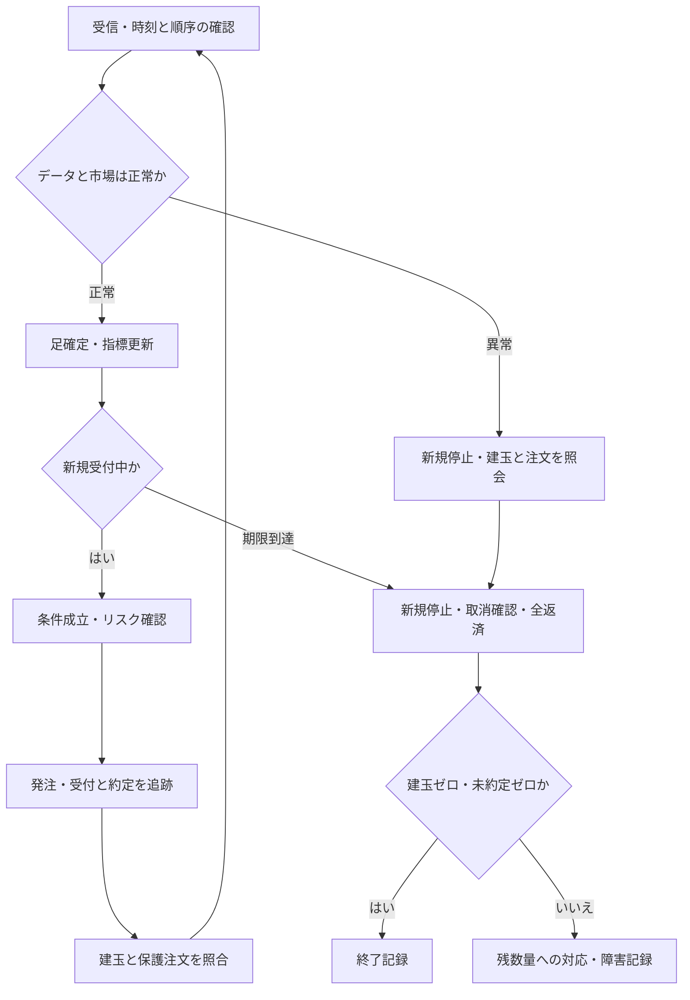

# 決済とリスク管理

作成・資料確認日：2026-10-30。ここで示す設計は本研究の候補であり、収益性を検証した売買ルールではない。

[教科書の目次](README.md) / [先物と執行の制約](03_先物と執行の制約.md) / [検証方法](05_バックテストと改善.md)

## 1. エントリーと決済を一つの手法として定義する

買い条件だけでは手法にならない。対象限月、分析価格、足の長さ、指標の初期化、売買可能な時間、数量、注文方法、通常の決済、保護注文、期限の決済まで定める。買いと売りを対称にするかも先に決める。

例えば「MACDが上向きなら買い」は曖昧である。「確定5分足でMACDがシグナルを下から上に交差し、長期平均が前足より上向きで、建玉と未約定の新規注文がなく、新規受付時刻内なら次の利用可能な板で買いを試みる」とすれば検証できる。約定価格はシグナルを作った足の終値で自動的に決めない。

同じMACDでも、反対交差まで保有する手法と、直近安値割れで返済する手法では別の損益になる。入口・出口・枚数の変更を同時に行うと原因が分かりにくいため、試行では変更点を絞る。

## 2. 決済の役割

| 役割 | 買い建玉での定義候補 | 検証すること |
| --- | --- | --- |
| 分析に基づく利確 | レンジ手法なら中心線に到達、追随手法なら勢いの失速や反対交差 | 利益を早く切りすぎていないか、条件判定と約定のずれ |
| 仮説が崩れたときの損切り | エントリー前に確定した支持帯の下側を割る | 支持帯・割れ・確認本数の数値化 |
| 保護用の逆指値 | 通常決済とは独立した価格条件に達したら返済注文を発動 | 監視場所、発動価格と実約定価格、未約定残 |
| 時間による決済 | 一定本数で進展がない、または決済期限に到達 | 機会損失と終端の流動性 |
| 運用上の決済 | 損失上限、データ異常、停止要求など | 発注可能性、既存保護注文との競合 |

通常のチャート判定を確定足で行っても、保護用の価格監視まで足確定を待つ必要はない。両者の観測周期を別々に定める。逆指値は損失額を保証するものではなく、発動後の注文にも価格と数量の制約がある。注文の通常条件・残数量取消・全数量執行等は取引所制度と証券会社の対応を確認する。[JPX「注文の種類等」](https://www.jpx.co.jp/derivatives/rules/order-types/index.html)

## 3. 損切り価格を置く方法

### 固定値幅

建値を `e`、固定幅を `d > 0` とすると、買いの保護価格候補は `e − d`、売りは `e + d`。比較用の単純な基準になるが、同じ幅でも時間帯や銘柄によって通常変動に対する大きさが異なる。

### ATRに応じた値幅

買いでは `e − k × ATR`、売りでは `e + k × ATR` を候補とする。`k` は検証前に決めた正数。ATRは発注時に利用できた確定足から求める。建玉後にATRが増えたことを理由に無制限に損切り幅を広げない。建値基準の初期値と、追尾する値を分けて記録する。ATR自体は方向を示さない。[指標の計算](02_指標の計算とシグナル.md)

### チャート構造

買いは確定済みの押し安値やレンジ下限の下、売りは戻り高値や上限の上を候補とする。許容幅を価格刻みの整数倍、またはATRの割合で追加する。右側の足を見て確定する安値を、その安値の発生時点で知っていた扱いにしない。[チャートの読み方](01_チャートの読み方と仮説化.md)

構造上必要な損切りが予算を超えるときは、枚数を減らすか取引を見送る。予算に合わせて支持帯の内側へ損切りを縮めると、元の仮説と異なる手法になる。

### 追尾する保護価格

買いの候補を `S_t = max(S_(t−1), H_t − k × ATR_t)` とすれば、保護価格を引き下げずに追尾できる。`H_t` はエントリー後、判定時点までに観測した最高値である。売りは最安値と `min` を使って逆向きに定義する。

ある足の高値で保護価格を引き上げ、その同じ足の先に発生した安値で発動したと判定してはいけない。順序が不明ならティック順で再生するか、楽観・保守の両ケースを残す。注文の訂正と取消後の再発注では旧注文の失効時点が異なり得る。APIの仕様に従い、旧注文が有効・取消中・失効した状態と、新注文の受付を区別する。保護が途切れる期間も検証する。

## 4. 枚数と初期リスク

1枚・価格1単位当たりの円価値を `M`、初期損切り値幅を `d`、1枚当たりの往復費用と不利約定の予算を `c`、1取引のリスク予算を `B` とする。

```text
1枚の計画リスク = d × M + c
リスク上の最大枚数 = floor(B / (d × M + c))
採用枚数 = リスク上限、証拠金上限、建玉上限、流動性上限の最小値
```

この計画リスクは急変時の損失の上限ではない。証拠金額も損失上限ではない。

計算だけの例として、日経225マイクロで `M = 10円`、`d = 100円`、仮の費用等予算 `c = 100円/枚`、仮の取引予算 `B = 3,000円` なら `floor(3000 / 1100) = 2枚` となる。これらの値は手数料の実額や推奨予算を示さない。ラージ・mini・microはそれぞれの倍率と呼値に合わせて再計算する。[JPX「日経225マイクロ先物・制度概要」](https://www.jpx.co.jp/derivatives/products/domestic/225micro-futures/01.html)

価格の丸めは浮動小数の誤差を避け、対象商品のティック数で扱う。買い建玉の下側へ丸めると損切り距離は広がる。丸め後の価格で枚数を再計算する。研究では1枚固定の比較も残すと、売買ルールの効果と枚数調整の効果を区別できる。

## 5. 1セッションで終える

本研究の要求は、デイとナイトをそれぞれ独立した保有期間とし、次セッションへ建玉を持ち越さないことである。取引所の取引日全体と、本研究のセッションを混同しない。

通常時のザラバ終了はデイ15:40、ナイト翌05:55で、引けの板寄せは15:45・翌06:00。終了時刻まで連続して通常約定できると仮定しない。[JPX「TOPIX先物・制度概要」](https://www.jpx.co.jp/derivatives/products/domestic/topix-futures/01.html)

設定として少なくとも `新規受付終了 < 全返済の開始 < ザラバ終了 < セッション終了` を置き、全返済開始以降はエントリー条件が出ても新規注文を受け付けない。期限は銘柄・取引日・市場状態から求める。

検証用の一例は、デイの新規受付終了15:25・全返済開始15:35、ナイトは05:40・05:50とするもの。ただし、この時刻は利益を検証した結果ではなく、執行余裕を設ける設計例である。早める場合と遅める場合の機会損失・返済失敗率を比較する。

終了処理は次の順を基本候補とする。

1. 新規受付を止め、新規の未約定注文を取消要求する。取消完了まで追加約定があり得るため確認する。
2. 約定照会と建玉照会で実際の残数量を確認する。
3. 返済注文を発注し、部分約定と残数量を追跡する。既存の利確・保護注文との重複返済を防ぐ。
4. 建玉ゼロを確認した後、残っている関連注文を取り消し、未約定ゼロを確認する。
5. 終了時点の建玉、未約定、約定履歴、障害を保存する。

停止や流動性枯渇で返済できなかったセッションは「持ち越しなしの要件違反」として記録する。終値で架空返済したり、記録から建玉を消したりして成功扱いにしない。観測欠損で判定不能な場合も、成功とは別に数える。

## 6. 注文を状態として管理する

以下は将来のWebSocket運用に向けた設計図で、発注システムの実装ではない。



受信したLastや足確定を「注文が約定した」という事実に置き換えない。発注要求・受付・部分約定・全約定・取消要求・取消完了・拒否を分ける。通信が切れた後は、照会で残注文と建玉を確定させてから次の行動を選ぶ。同じ要求を再送する場合は注文識別子で重複を防ぐ。

チャートの通常決済、保護注文、期限返済が同時に発生することがある。建玉単位で決済処理を調停し、約定済数量だけ保護注文を減らす。実取引側のOCO等の対応が未確認なら、それを利用できる前提で設計を確定しない。

## 7. 障害への備えも検証対象にする

| 事象 | 事前に決める動作・確認事項 |
| --- | --- |
| 足データの欠損・古い値 | 新規停止、未確定指標の無効化、再開に必要な観測期間 |
| WebSocketの切断・再接続 | 欠落区間、重複、順序、履歴取得可否、注文・建玉照会 |
| 保護注文の拒否 | 約定済建玉を保護できない間の扱いと、新規の禁止 |
| 注文送信後に応答がない | 未受付と決めつけず照会。再送による二重発注の防止 |
| セッション損失上限 | 確定損益だけか含みと想定返済費用も含むか、到達後の返済と再開条件 |
| 売買停止・制限値幅 | 返済不能の明示、保護価格で約定したとの仮定禁止 |

ローカルで監視する逆指値はプロセス停止時に動かない。証券会社側で監視する注文も、その会社の稼働・条件・受付を確認する。どこで何を監視するかは将来利用するAPIの仕様として確定させる。通常決済と独立した保護を用意しても、約定保証に読み替えない。
