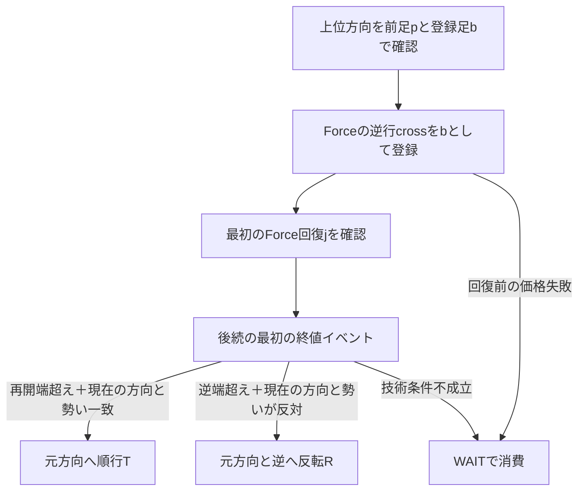

# Force Index（EFI）と時間順の複合判断

確認日2026-11-06。Force Indexは、終値の変化幅に数量を掛け、平滑して使う指標である。上位足の背景、下位足の逆行と回復、価格による実行を役割別に考える。ただし、数量を掛けたことだけで予測力が増すとは仮定しない。

## 定義と観測できること

[TradingViewの公式説明](https://www.tradingview.com/support/solutions/43000502259-elder-s-force-index-efi/)と[thinkorswimの公式仕様](https://toslc.thinkorswim.com/center/reference/Tech-Indicators/studies-library/E-F/ForceIndex)は、現在終値と前終値の差に数量を掛け、EMAで平滑する形を説明する。前者の標準設定は13期間だが、短い逆行波を扱う本研究では2期間を選ぶ。式の意味と、採用する期間・種の規約を分ける。

```text
X_t = (C_t−C_(t−1))*q_t
F_N,t = alpha*X_t + (1−alpha)*F_N,(t−1)
alpha = 2/(N+1)
```

Xの符号は価格変化の方向、絶対値は変化幅と数量の積である。同じ値幅でも数量が大きければXが大きい。ただし、成行買い/成行売りの符号付き約定量、買い手の人数、資金流入額、新規建玉そのものではない。

本リポジトリのqは、[数量の監査](../../../study/00014_反転入口と観測差分量/README.md)に従う**観測累積数量の差分**である。受信時計や全約定を完全に観測した出来高とは区別する。完全な有限非負qだけを使い、不完全なqを0へ埋めない。価格足・数量の利用可能時点・限月を一致させる。

## Force2の初期化と欠測を固定する

試行47の規約は、最初の有効公開価格を比較元とし、次の連続する有効X二つの算術平均を初F2にする。その後はF2=(2X+前F2)/3。元C/qを個別にFractionへ写し、値・分子・分母・厳密符号を分けて保存する。

```text
有効価格1本目 → 有効X1 → 有効X2でF2の種 → 次の足から符号crossを判定可能
```

有効Xには当足qが必要だが、比較元の前足qまで要求しない。価格が正常でも数量だけ不完全なら、X/EMAの連続列を切り、その終値を次の隣接足の価格基準には保持できる。価格NP・欠枠・不正・場替わり・番号/区間の飛越では局所価格とForceを切る。飛越後のmissing0正常当足は新しい価格の種にできる。

完全0qは有効でX=0となる。前F2が正なら次F2はその1/3で、現在数量0でも正を保てる。したがって正の平滑値を「現在も買いが増えた」と説明しない。全0で種を作ったF2=0も準備済みであり、未準備ではない。これらは種を含む研究規約で、特定ソフトの全数値を再現すると主張するものではない。

## 同じ価格情報を何票にも数えない

元方向s（買い+1/売り−1）に対してs*F前≥0からs*F当<0へ交差すれば、逆行波の候補になる。前Fが既に準備済みの通常EMA更新では、このcrossはs*X当<0を必要とする。qが有効非負なので、q当>0かつ実方向と逆の終値変化も含意する。その価格逆行をさらに独立した確認票に数えない。

qが常に同じ正定数なら、Force2はEMA2(終値差)の定数倍に退化する。数量を入れたことと独立な数量情報が加わったことは異なる。数量・値幅の大きい一足が符号を変える場合もあり、複数条件を満たしたという理由だけで確率を掛け合わせない。

価格反射C'=2a−C、高安を交換、qを維持するとX'=-Xとなり、同じ線形初期化/EMAもF'=-Fとなる。売買の閾値・0等号・寿命・公開時点・取消を同じ鏡像条件にできる。絶対価格TP*qを重みにする標準MFIとは性質が異なる。

## 背景・波・価格実行を時間順に使う着想

[Elder本人の製品ページ](https://www.elder.com/product-page/elder-disk-v3-for-metastock-v15-with-scanners-1)から直接公開された[2017年のマニュアル](https://6e6fa188-f273-4932-86c0-66af721f16a8.usrfiles.com/ugd/6e6fa1_c70983b8ebfa4100945b4c05c5f76c40.pdf)は、上位MACDヒストの現前関係で背景を見て、下位Force Indexを使う構成を説明する。Forceの既定平滑2は印刷11頁、上位/下位の役割は45〜46・52頁を参照した。有料ソフトや書籍を購入・複製せず、公開説明の該当箇所を確認した。

[MTAの本人講演に関する会合報告（2004年5月、6頁）](https://docs.cmtassociation.org/docs/MTA0405.pdf)も、長期方向、下位の逆方向の波、価格を使う実行を分ける考え方を伝える。これは会合主催者の一次報告で、本人の原稿や本先物の検証ではない。本研究の二尺度・6足寿命・回復後の端・失敗反転は独自の仮説とし、原典の完全再現とは呼ばない。



監視中は、数値準備の断裂・期限・寿命等による取消も別にある。単に上位が0や逆向きになっただけで反転注文にはしない。

## 試行47の再利用可能な機械条件

[試行47](../../../study/00047_上位方向とForce波からの価格発動/計画.md)は次の独自条件を事前に固定する。3分判断key=(確認価格時計,原行)以下、かつ上位end≤下位endで利用可能な当場最新15分足uと、その可視の隣接前足から、D=sign(H15_u−H15_(u−1))を得る。ヒスト水準の正負ではない。最新が未準備なら古い正常ペアへ代替せず、未来の足の存在で理由を細分しない。

|段階|買い元方向s=+1の条件|固定するもの|
|---|---|---|
|背景|下位pとbでD=+1を既知|両時点の上位出典。参照uが同じでも独立二回の確認とは数えない|
|逆行波b|F前≥0かつF_b<0|bと元方向、逆端L_b|
|初回回復j|最初のF_j>0、現在D=+1|j高値H_j。D不一致ならWAIT終端|
|再開k|j後に終値C_k>H_jの最初の価格端。現在D=+1かつF_k>0|実side=+1、T順行|
|失敗f|j後に終値C_f<L_bの最初の価格端。現在D=−1かつF_f<0|実side=−1、R反転|

売りは高安・符号を反射する。回復前に終値がbの逆端を破ればWAIT終端を優先し、Rにはしない。j後は最初の端を一回消費し、技術・時間が不成立でも後の別端を取り直さない。ヒゲが両端に触れた足から有利な順序を作らない。

監視は全体で一つ。元bから6足までで、回復jで寿命をリセットしない。各段階の後続足はend>親段階のconfirmかつkey>親keyを要求するが、start>親confirmは要求しない。対象時点外の足も年齢に数える。監視中や終了同足の別crossは置換・再登録せず、抑止を残す。

bの登録時計はdeadline前だけとし、ATR・新規停止・残60分・確認遅延30秒は最終k/fの採否で判定する。Force又は最新上位ペアの準備が切れれば監視を取消す。D=0/逆向きだけなら準備済みとして監視を維持するが、初回回復のD不一致や最初価格端の技術不一致はWAITとして終える。現在ATR未準備は最初価格端でWAIT消費する。

登録候補の受理/抑止、回復前WAIT、回復後の初価格端、純採用、仮約定、実一建玉を別の分母にする。比較はTのみ・Rのみ・S=T∪Rの三案で、Force単独や上位方向単独の寄与を分離した実験ではない。Sの純和集合が、実参加や損益の単独和になるとは限らない。

## 数値・執行・未確認の範囲

3分ATRと数量参照は固定29の保存材料を使い、原観測から別検算する。15分OHLCは固定28から共有するが、そこに本研究の中心化ヒスト保存値はないため、15分Hは固定29の中心化式を使う**新計算**とする。同限月carry・完全NP内部更新・欠枠/不正/尾部解除を明示し、不完全幅は投入しない。正本Hの小型3列定義と、独立生Hの限定許容/全方向・採否strictを分けて保存する。

入口はk/fの公開後に要求し、+1秒以後の最初正常BBOで評価する。過去のb/j価格や閾値で入れたことにはせず、実sideの新価格から125/250を計算する。全三案のXFは現在返済BBOの粗含み益円−122円>0で起動し、入口時ATR固定D・最低名目entry床・非緩和・場内完結を維持する。名目床は費用後同値/同値約定の保証ではない。

上位方向が続く中の数量加重逆行を押し戻り候補とし、回復後の価格再開を確認するのが心理の仮説である。逆端を破り、現在上位とForceも反対なら再開仮説の失敗候補とする。ただし注文の意図や需給の転換を直接測った事実ではない。全66場は既使用、支持・70%・費用後黒字は検証まで未確認。Rが薄くても寿命・境界・支持を成績後に緩めない。

旧23等の多段監視と重なる設計を再利用し、Forceの名前だけで全く新しい手法とはしない。旧版を変えず、[汎用表・版5](../../議論/手法と時間スケールの汎用表_版5.md)のV07にForceを記録する。I03の上位MACD、P02/P03/P07等の価格構造、I09/執行・評価・保護との役割を分け、複合成績をV07単独の効果へ帰属しない。

資料は全て2026-11-06確認。公式の一般用法、作者の着想、心理の仮説、研究上の機械規約、今後の実測を区別する。
