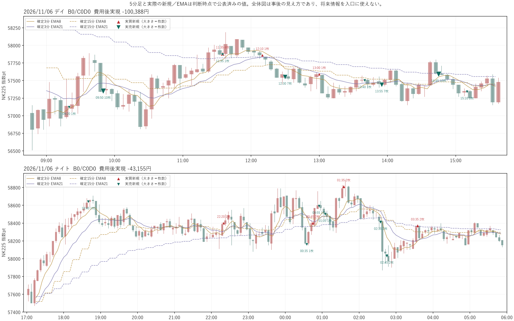

# 11月06日の赤字を入口と利益保護から診断する

確認日：2026-11-09。対象は固定済み[試行107](../../study/00107_見送り明けの初回取得と利益保護/README.md)の2026-11-06デイ・ナイト。ナイトの0時以降は11/07である。既存の実約定と実保有を診断し、新条件による損益を計算した結果ではない。

今回確認できた主要な問題は、**一度費用後利益になっても、ATR比例の起動水準へ届かず赤字決済すること**と、**起動しても追尾幅が広く、利益を保護する価格まで床が上がらないこと**だった。入口も、元手法の複合判定を引き継ぐ一方、5分取得時に追加の中短期環境を照合していなかった。「チャートが難しかったから」で片付ける結果ではない。

## 全体の収支と図

主費用条件C0D0。ラージBBOによる約定モデルとmini片道税込38.5円/枚を含み、追加5pt滑り・価格時計1秒遅延は加えない。実運用の約定実績ではない。

| 候補 | デイ純損益円 | ナイト純損益円 | 比較する変更 |
| --- | ---: | ---: | --- |
| B0 | -100,388 | -43,155 | 従来時計、通常1ATR起動・2ATR幅 |
| B1 | -123,388 | -43,155 | B0に収束・失速時の幅縮小 |
| BE | -87,388 | -43,155 | B1に半ATR利益＋収束・失速の早期起動 |
| Q0 | -100,388 | -42,232 | B0の静観内割当を一回繰越 |
| Q1 | -123,388 | -42,232 | B1の同上 |
| QE | -87,388 | -42,232 | BEの同上 |

B0はデイ13建玉・新規44枚、ナイト10建玉・新規15枚。各瞬間の片側上限10枚と、セッション内の累計新規枚数は異なる。費用条件を含む全24設定の70場は[全セッションCSV](../../outputs/01a1889f-f2af-7943-a047-543275ee9ed2/107損益CSV/全セッション.csv)、集計は[候補別CSV](../../outputs/01a1889f-f2af-7943-a047-543275ee9ed2/107損益CSV/候補別集計.csv)で確認できる。

ローソク足は共有5分CSV、線は判断付近までに公表された確定3分・15分EMA。矢印は実際に成立した新規で、同時刻・同価格・同方向は枚数を合算した。全体図は事後の見え方であり、将来の高安を当時の判断に使えるという意味ではない。未参加・決済後の仮想収益は評価していない。

## 利益保護で実際に起きたこと

主B0の赤字だけを分類すると、次の通りだった。黒字建玉も含む日計は上表と一致する。

| 実建玉の状態 | デイ赤字建玉数 | デイ赤字合計円 | ナイト赤字建玉数 | ナイト赤字合計円 |
| --- | ---: | ---: | ---: | ---: |
| 費用後プラスを観測、Actor利益保護の起動前に赤字決済 | 6 | -251,617 | 5 | -168,616 |
| Actor利益保護の起動後に赤字決済 | 1 | -7,539 | 0 | 0 |
| 費用後プラスを観測せず赤字決済 | 2 | -26,154 | 0 | 0 |

「未起動」は外側Actorの利益保護についての記録であり、元Sourceの停止・返済が存在しないという意味ではない。また、短時間でもプラスを観測したという分類であり、各玉が十分大きな利益へ到達したとは限らない。

**09:50の売り7枚**は57,350で新規。取得時のnative5分ATR12が491.31ptで、通常の起動水準は1枚当たり費用後49,131円、追尾幅は985ptだった。10:24:57に1枚49,923円・7枚349,461円の費用後含み益で起動したが、幅が広いため保護床は建値のまま。10:33:31に57,360で返済し、価格差-7,000円と手数料539円で **-7,539円**になった。利益保護の存在と、実際に利益を守れる設定は別だった。

B1では同じ玉について10:33:01の収束・失速で幅が495pt、床が建値から35pt有利な位置へ上がった。10:33:27に57,310で返済して+27,461円、B0より35,000円改善した。ただし14:45の別の売り3枚はB0の+99,769円に対しB1は+41,769円で、実現額が58,000円減った。B1の日計差は `+35,000−58,000=−23,000円`。幅縮小を一律に有効とは結論できない。

**11:35の買い4枚**はB0では通常未起動のまま-36,308円。BEでは11:49:11に半ATR利益と収束・失速で起動し、11:59に57,880の名目建値で返済して-308円となった。同じ入口で36,000円の実損失を軽減した例だが、名目同値では手数料赤字が残る。

**ナイト02:45の売り2枚**は半ATR水準9,194.17円/枚へ達した観測が249件あった。それらはすべてMACD失速が真、平均間隔の収束が偽で、早期起動の同時条件を満たしていない。金額達成時の必須保護と、技術的な幅変更を同じ厳しいAND条件へ結び付けてよいかが次の問いになる。ほかの赤字4玉は保有観測上、半ATR額にも達していなかった。

## 入口は何を見ていたか

「追加Gate無し」はテクニカルを使わない入口という意味ではない。元Sourceには異なる経路がある。

- core：確定1分のEMA15/60間隔と遅いEMAの変化をATRで正規化し、二市場の支持などを組み合わせる。
- episode：デイでは1分境界直前の正常気配midを標本化した20分帯からの逸脱と回復確認を使う。
- addon：20/40分の価格構造・効率などで順行とレンジ反転を切り替え、再試験や二市場支持を使う。

ただしこれらの出生を5分枠へ割り当てた際、追加の3分・15分環境で再判定する変更は107の比較に入っていない。追加した平均の収束CとMACD失速Mは主に保護の切替へ使った。デイB0の実現額を元経路で分けると、core3建玉12枚-92,924円、addon4建玉18枚-46,386円、episode6建玉14枚+38,922円だった。経路ごとに根拠を読む必要がある。

元Sourceの価格帯は、境界より前・90秒以内の正常BBO midを1分ごとに採り、境界+60秒で公開する実装である。共有CSVのLast終値帯と同値とは確認していない。以下の57,400は追加5分OHLCから求めた下端で、元Sourceの20分mid帯そのものではない。

具体的には以下を確認した。

| 場面 | 当時の確定値・実取引 | 次に検証すべき区別 |
| --- | --- | --- |
| デイ09:50売り計10枚 | 3分EMA8−21は+136.06pt、15分は-542.73pt | 短期上昇中の逆張りが成立する価格否定を確認したか |
| デイ13:55売り7枚 | 両足のEMA差とEMA傾き、MACD変化は売り側。新規57,440に対し直近確定20分の下端57,400は未突破。実現-119,539円 | 方向一致だけで下端近くを売るのか、突破確認か戻り売り確認が要るのか |
| デイ14:45売り計10枚 | 3分EMA差は+57.8ptで売りと逆。2建玉の実現合計+182,230円 | 逆方向という理由だけで、成立した反転まで除いてよいか |
| ナイト01:35買い2枚 | 両足EMA差とMACD増分が買いを支持しても、実現-52,154円 | 勢いの継続と上端での一時的な伸びを、構造・量・利益保護で区別できるか |

ここで「EMA差」は同一足のEMA8−EMA21で、傾きではない。傾きは異なる二本の確定足間の変化として別に確認した。追加3分・15分EMAは同限月の前セッションの数値種を継承するので、中期には前場の動きも残る。一方、利益保護のnativeATRは当場5分足の先頭TRを初期値にして1/12更新する別実装で、教科書の12本SMA初期化や追加3分ATR14と同一ではない。先頭TR640ptの影響が09:50の491.31ptにも残っていた。

全141建玉で、根拠足の初回公表観測・available_at・delivery.at・frame.available_atが注文要求以前で、3分10列と15分EMA2列が記録値と同値であることを確認した。判断枠のsnapshot観測自体が名目枠より1〜2秒後の36建玉も、別の初回公表と照合した。当時の5分足構造と量には、足開始+300+60秒という保守的な公開遅延を適用し、数量の未完備を補完していない。

既存B0実建玉を「両EMA差が取引向きだった」で記述集計しても、デイ5建玉17枚は実現合計-195,309円、ナイト1建玉2枚は-52,154円だった。これは仮想ゲートのバックテストではなく、実在取引の分類である。単に同方向の条件を追加すれば改善するという根拠にはならない。

## 市場心理を次の判別へ変換する

以下は心理の仮説であり、参加者の注文意図を観測した事実ではない。

帯の下端へ近づく局面では、新規の売りだけでなく既存売りの利益確定や買い指値も考えられる。平均と勢いが下を向いていても、その価格帯を実際に抜けて維持するか、帯内へ戻るかは別の問いになる。逆に短期の上昇中でも、上端を更新できず確定した支持を失えば反転候補になり得る。[需給と流動性](../technical-analysis/市場心理/需給と流動性.md)、[収束と失速の根拠・反証](収束と失速を分ける可変追尾の候補.md)を参照する。

次の候補は、方向と傾き、RSI/MACDの持続・変化、確定済み価格帯の突破/復帰/再試験、完全性を確認した数量という役割を分ける。順行不成立を自動的に反転成立へ変換せず、反転には逆方向の価格確認を求める。買いと売りは符号反転した同じ条件とし、同時に両方向が強い場合の競合処理も先に定義する。

同日の追加指示を受け、次の入口比較は**5分・15分・30分**の3時間軸を使う。30分は大きな背景、15分はその中の押戻し、5分は実際の取得確認。今回記述診断した既存3分・15分値を5分・30分値へ読み替えず、新しい確定足と公開器で検証する。順行の3軸整合と、長期へ逆らう反転の成立条件を分ける。[3時間軸の方針](5分15分30分で入口の環境と確認を分ける.md)を参照する。

利益保護は、一定の費用後利益に達した時点の必須起動と、その後に技術的失速で幅を狭める判断を分ける。取得時ATRだけでなく、直近確定足の値幅・既知の価格構造による幅も候補にする。床は不利に緩めず、費用回収を狙った床も比較するが、逆指値の価格での約定は保証しない。

これらの改善効果は未検証。11/06だけへ合わせず、全既使用セッションの収支・利益後赤字・DD・参加率を比較し、固定後の未使用データで確認する。5分判断、静観時間、片側上限10枚、参加率最低25%と目標50%、セッション内完結の条件は別々に記録する。

## 出典と再現

正本は試行107の結果・Native参照台帳・11/06のNative2点、同台帳に結び付く試行106の保存公表列、共有NK225の5分CSV。出典と指紋は[小台帳](資料/11月06日診断/出典と確認.json)、コードと再現手順は[scripts/11月06日診断](../../scripts/11月06日診断/README.md)に残す。大量の指標・建玉一覧は `work/` へ再生成し、正式資料に全件転記しない。

48会計すべての実約定純額・実建玉純額・返済配賦純額を保存済み結果と照合した。主12会計・141建玉のnativeATRも共有5分足から独立再計算して一致した。固定済み試行107・108の条件と結果は変更していない。今回の記述診断を新しい手法の成績とは数えない。
