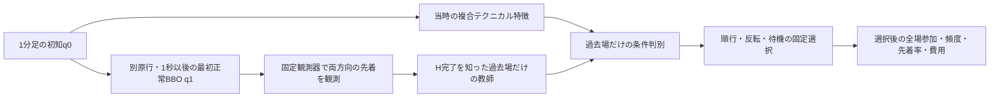

# 入口の母集団を広げて技術局面の良否を評価する方針

2026-11-12。次の研究方針であり、広い母集団の生成・学習・70%達成はまだ実行していない。試行147の条件や固定結果を変更しない。

## 147までで確認した制限

[147](../../study/00147_中位足の価格位置と短期実体回復から入口を生む/README.md)は、1分実体回復に5分EMA接触・Hist実増分、15分DI/ADX、30分方向、BB15の位置/125pt余地、量を組み合わせた。全73場で技術完成13→出生6→取得5、取得したのは4場だった。技術完成を全て取得しても約0.018回/時なので、取得capだけの緩和では全体平均概ね1回/時へ届かない。

新5件は2順/1逆/2未到達＝到達済み66.67%、C5利益23,846円/損失31,231円/差引−7,385円。旧87を残した統合92件は44順/19逆/23未到達/6不足＝69.84%、C5利益568,842円/損失365,695円/既知差引+203,147円、金額未知3。全場最低1は維持したが、平均0.12762回/時で共同目標未達。新5件は全て前48場に属し、後25場の新取得は0だった。

これは複数テクニカルが不要という結果ではない。狭いANDを先に通過した入口だけでは、良否を比較する母集団自体が小さくなる。EMA接触・上位の動力・短期回復を同時に要求する前の場面も保存し、どの組合せで順行・反転・待機を切り替えられるかを調べる。

## 研究母集団と売買候補を分ける

価格既知・closed・freshな1分足を初めて知ったイベントから、当時特徴と取得代用を結ぶ広い母集団を作る案を検討する。全件を取引する時計ではなく、最終的に選んだ取引だけで参加・頻度・先着率を評価する。母集団の件数や売買2方向の教師行を、エントリー回数に数えない。

|役割|出生時に残す情報|判別したい差|
|---|---|---|
|方向と強さ|5/15/30分のMA、DI、ADX|上位継続、短期調整、新方向の強化|
|勢い|各足のHist位相/増分、RSI中心/増分|減速と逆方向の成立、持続と異常な加速|
|価格位置と構造|当時Ask/Bid/LastとEMA/BBの距離、既知高安、実体/ヒゲ|追いかけ、押戻し、失敗突破からの回復|
|値幅|ATR、TR、125ptとの比、既知水準までの距離|短い反発と125pt持続を混同しない|
|量|同足量、直前比、RVOL|形状と同じ足に伴う活動の変化|

バンド端を将来の静的抵抗と断定しない。量の増加だけで売買方向を決めず、複数役割の相互作用として扱う。心理の説明は参加注文の再開/失速等の仮説であり、注文目的を直接観測した事実ではない。

## 時計と検証の境界

1. q0は既存CSVモデルのEnd+60以後の最初の採用Raw。特徴にはq0までの価格と公表だけを使う。q1実価格・将来品質・先着結果をq0の特徴へ混ぜない。
2. q1は別原行・q0+1秒以後・TTL30秒以内の最初の正常BBOを基本案とする。取得限界・ザラバ・売買対称な実側を事前固定し、後の好価格へ取り直さない。具体契約は新試行で固定する。
3. 147の保存1分/Contextを再用できるが、非パターン足のq1は保存されていないため取得用のRaw再生が必要。全特徴には固定122の当時公表を結合する。原板の再複製はしない。
4. 観測は可変取得数に対応する凍結133を優先する。約4万という規模は146の配送足数による概算で、適格数ではない。active更新に加え、全結果保持・JSON出力の時間/RAM/容量を測り、必要性を確認してから変更する。
5. 先に少数の可読ルールを対照として固定し、学習を採用する場合も、当場開始前にH完了を知った過去場だけを教師にする。近接した60分窓を独立標本とせず、場単位の時系列分離・重み・不確実性を扱う。
6. 143の752固定入口・方向だけの学習は51.12%で不採用だった。広い入口品質の母集団と価格位置を調べる案は別の仮説であり、学習器を使えば改善するとの結論にはしない。

全期は既使用。モデル確率0.7を実先着率70%と呼ばず、未到達/不足/取得不可を別記する。売買は鏡像、旧C1全87は固定対照、同原行aliasは1物理取得とする。新streamと統合を分け、**全73場最低1・全体平均概ね1回/時・実BBO/H60±125ptの先着70%**を維持する。高頻度場と1回だけの場は許容し、均等化・強制毎時新規・重複注文で回数を作らない。

費用は独立mini1枚・往復77円とC5追加往復1,000円を区別し、利益/損失/差引/未知を残す。母集団全件や重複保有の仮想収支を、10枚口座・必須利益追尾の運用成績とは扱わない。生成入力は一度の恒久保存と共有参照、閲覧用はCSVを継承する。

## 148で広い記録を作った結果（2026-11-12）

[148の正本](../../study/00148_全1分知得から入口品質の母集団を固定する/README.md)で、全73場の40,544台帳・35,339適格q0・買売各100特徴・31,632取得eventを保存した。旧C1再用77と新31,555を結び、未参照10も含む旧87を保護した全31,642caseの正逆を観測した。旧ANDを先に直列で通す薄い成立集合を越え、良否を比較する記録の土台ができた。

ただし、取得研究q1全31,632を機械的にBUY/SELLとしたH60±125の到達済み先着率は43.11%/46.44%である。未到達・不足・IFD未知を分けても、全件が高精度とは言えない。全件の独立1mini/重複IFD代用利益損失は運用口座の収支ではない。旧C1の87件・70%は固定対照を維持した結果で、新しい選択政策の達成ではない。

広く記録することと実際に取引することを分ける。148の主政策・最終選択取引数・頻度はnull。後続[149の固定可読8局面](../../study/00149_継続と反転を可読8局面で判定する/README.md)で、方向/強さ・勢い・価格位置/125pt余地・量・構造から選別する。選別後の70%・全場min1・平均概ね1回/時は別途判定し、母集団件数を合格の代用にしない。全期間既使用・近接H60窓の依存・価格時計の限界を維持する。
