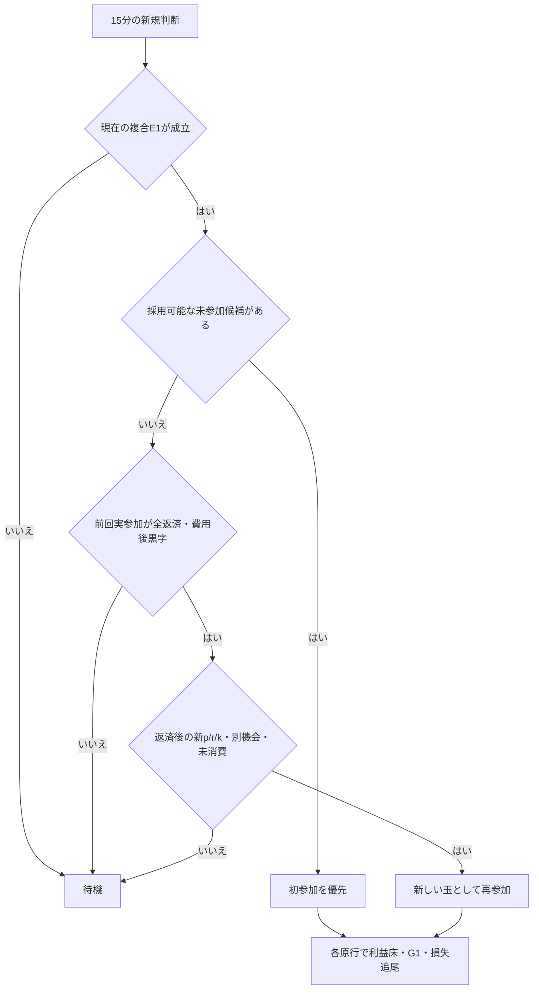

# 利益保護後の新しい押戻しを別機会とする

確認日：2026-11-08。[91の検証計画](../../../study/00091_利確完了後の新しい再開へ再参加/検証計画.md)の外部根拠と独自条件。

## 一般的な説明

CMEのテクニカル教材は、トレンドの途中にも利確や他市場・ニュースの影響による逆方向の動きがあると説明している。また価格へ勢いや量の分析を加える考え方を示している。調整が起きたという事実と、元の方向が続くという判断を分ける参考になる。[CME：Technical Analysis](https://www.cmegroup.com/education/courses/trading-and-analysis/technical-analysis)

継続パターンの教材では、三角形・矩形・フラッグ等の調整と再開を説明し、パターンは必ず継続を示すわけではなく、他の根拠と組み合わせるとしている。今回のi→p→r→kはこれらの図形を検出する実装ではない。[CME：Trend and Continuation Patterns](https://www.cmegroup.com/education/courses/technical-analysis/trend-and-continuation-patterns)

## 心理の仮説と今回の機械条件

トレンド中の利確による押戻しであれば、利益を一度確定した後にも、方向を支持する参加者が残って新しい再開が起きる可能性がある。ただしNK225の参加者の意図をこの資料や終値から直接観測したものではない。逆方向の進行や、同じ価格帯での往復も起こり得る。

91では、前回の費用後利確完了を履歴資格にし、その後に公開された別eventのp/r/kを要求する。元FARの価格・量条件を持つSourceの全原行運転と、現在参照量以内の取得を維持する。当定時にはE1の15分背景、3分平均回復、MACD/RSIの勢い、ATR取得位置、急変警戒、event順序を再検査する。元参照の生成時条件を全て現在時点で再判定しているとはしない。過去の利確額は現在の方向の根拠や新玉のcash予算へ流用しない。

元参照のID、別eventによる機会ID、実玉IDを分ける。一度受理した「同じ場・元参照ID・eventの機会」は取消でも消費したままとし、同じ足の再表示へ反復発注しない。実取得0の取消は新たな実利確を作らない。最新の実取得世代が損失なら過去の勝ちへ戻らない。

これらの履歴資格・ID・公開順・優先順位は本リポジトリの独自研究条件である。CME教材はこの再参加規則やNK225の費用後収益を検証していない。

保有中は新規を行わず連続保護を行う。図の「待機」は候補資格の不成立を簡略化したもので、正式集計では未知・占有・静観・待ちを分ける。

## 何を反証するか

- 新しい再開に見えても同じ価格帯の往復で、費用と小損失を増やしていないか。
- 再参加が占有し、その後の初参加の機会を失っていないか。
- 前回の確定益と新玉の含み益を混ぜ、利益保護を実態より良く見せていないか。
- 先行していたSource通知や、返済より前に公開された足を、新玉へ遡及していないか。

一因子比較では現在のE1/G1を固定し、90の価格線やER境界を同時に足さない。再参加による総額差と、初参加の取得変更・片側参加・同入口の出口差まで集計して次の技法判断へ戻す。
