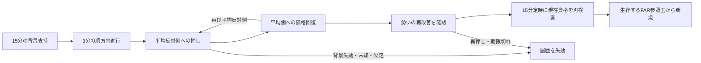

# 現在の状態と押戻し再開の順序を分ける

確認日：2026-11-08。[88の事前計画](../../../study/00088_背景維持と押戻し再開の時系列比較/検証計画.md)に使う理由を整理する。資料の一般論、心理の仮説、機械化した独自条件、検証済みの事実を分ける。

## 資料から使うこと

[CME：Trend and Continuation Patterns](https://www.cmegroup.com/education/courses/technical-analysis/trend-and-continuation-patterns)を再確認した。調整・収束と、その後の再開を区別する説明であり、形状だけで継続を保証せず他の根拠と合わせる教材である。EMA8の反対側からの復帰を、そのままフラッグや三角形の実証と呼ばない。

[Schwab：How to Read Stock Charts and Trading Patterns](https://www.schwab.com/learn/story/how-to-read-stock-charts-and-trading-patterns)は、高安の推移、支持抵抗への再接近、反転の確認を価格の経過として説明する。MA・数量・価格等を組み合わせる一般説明であり、日次株式の例を3分NK225の有効な閾値へ転記しない。今回のEMA回復は独自の機械的な代理条件で、高安構造をすべて認識したものではない。

既読の[Osler：NYFed SR125](https://www.newyorkfed.org/research/staff_reports/sr125.html)の書誌・要旨も再確認した。FX銀行の利確/損切り注文の異なる配置から、価格帯での反転と通過後の進行を説明する研究である。NK225のEMA8付近に同じ注文集中があること、今回の3分/15分条件が収益を生むことを示す資料ではない。標本・原文の詳しい確認は[既存の整理](市場心理と価格構造.md)を参照し、新発見として数え直さない。

## 心理を順序の仮説へする

買いの背景が保たれていても、利確売りや買い待ちによる調整は起こり得る。平均の反対側へ来た事実だけでは、通常の押し、支持の失敗、次の下落への移行を区別できない。価格が平均側を回復し、勢いも改善するなら、再び買いが優勢になるという説明を検討できる。注文目的や参加人数を直接観測したものではない。

売りは価格差・勢い・RSI増分の符号を反転し、同じ経過で判断する。MACDとRSIは同じ価格系列に由来するため、独立した二票とは扱わない。TR/ATRは急変と取得位置、元FARの板/数量条件は参照の選定という別の役割を持たせる。

推進・押し・価格回復は異なる確定足を必要とする。価格回復と勢い確認は同足でも後続足でもよい。この順序が観測されたことと、定時の価格がまだ取得に適していることを別に検査する。

## 88で比べるもの

E0は上位背景、現在の平均側、MACD/RSI増分、非スパイク、0..1ATRの現在取得位置を見る。E1は同じ現在資格に上記の履歴を加える。3分EMA8/21の配列が完成するまで待つことや、新しい同方向E08帯を常に要求する条件は追加しない。

再開確認は直近の一判断区間だけ有効とし、次の枠へ期限を延長しない。15分定時に条件を満たしても、押しが観測されていない経路はE1の再開と呼ばない。後から選んだ安値や将来の峰は条件に使わない。

原Sourceが生まれる前にチャートが回復した場合も、同窓・直近区間であり、要求時にSourceが生存するなら候補にできる。ただし「元Source支持下で全段階が起きた」という説明はしない。原Sourceの経過、最新snapshotの鮮度、再開確認からの経過を別項目にする。

## 失敗しても残す反証

87の静的な積極肯定18玉も赤字だったので、形の説明が整ったことを利益の証拠にしない。順序を待つため良い初動を失う、回復がダマシになる、定時までに進み過ぎる、現在の複合条件が細かい往復を選ぶ、といった反例を同じ比較へ残す。

最低建値床の即時起動と、G1が初期小益で大半を収穫する配分も別問題である。88は金融を同一に保ち、入口の経過だけを比較する。利益初回の技法状態を後の足で補うことはせず、今後の配分研究には当原行の記録が必要になる。

本稿時点で88の新損益は未計算。これは収益策を確立した結論ではなく、[87の取得遅れと回収](../FAR参照玉と可変量で分かった取得の遅れ.md)を踏まえた、次に反証可能な比較である。
