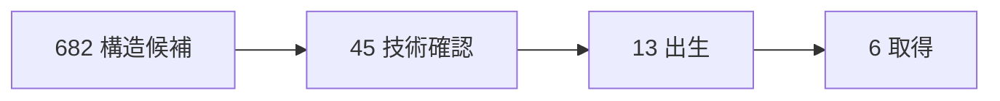

# 同じ方向状態ではなく、新しい構造イベントで生む入口の候補

2026-11-12。未採用の設計案。145の採番・実装・自然生成・閾値探索・損益計算はしていない。追加2場・Raw・価格CSVも開いていない。[144](../../study/00144_旧P3のstrongを全時間で評価する/README.md)の後続257取得が48.13%だったことは動機であり、個々の敗因を「押戻し不足」と確定したわけではない。

新5分IDは再判定の機会であって、新しい押戻しや反転が起きた証明ではなかった。次は**調整又は失敗試行を保存し、その後に価格構造を回復した1episodeから1出生**にする。144のstrongへ条件を足して間引くだけでは、件数の不足も改善できない。以下は144の全5分MA/RSI/score同時状態を必須にせず、異なる位相から独立に生むstream案である。率・頻度の改善は未確認。

## 案A：上位方向内の新しい押戻し→調整足の高安回復

優先して仕様化する候補。s=買い+1/売り−1で鏡像とする。

|段階|具体化する内容|
|---|---|
|方向と強さ|30分Gap/EMA21増分がs側、15分DI差がs側。ADX15増分が非負の間を継続候補とする仮置き。MAの方向とADXの強さを別役割にし、同じEMAの傾きと終値位置を独立票に数えない|
|新しい調整p|確定5分でs実体<0、sΔHist<0となり、直前5分のEMA8/21帯へ高安が接触した足を保存する。過去の良い接触を後から選ばない。参照EMAはEndがp.Startの足を明示し、p公表を知った現在に初めてパターン認識したものとする|
|凍結する構造|買K=p.High+1呼値/I=p.Low−1呼値、売は鏡像。ATR、EMA参照、p ID、K/Iをpの知得時に固定。p後の足で都合よく高安・ATR・Kを描き直さない|
|調整完了r|別の後続確定5分（r.Start>=p.End）でs(Close_r−K)>0、sHist_r>0、sΔHist_r>0。**同じrの量>=直前連続5分の量>0**を要求する仮置き。減速の終わりと元方向への再開を、別時点の構造と勢いで束縛する|
|出生現在|rと必要背景を実配送済みになった現在RawでLastもKのs側。実Ask/Bidが遅れた位置でないかをcap/riskで検査する。pやrのCloseへ遡って取得しない|

5分の全MA整列やRSIの一定帯を待たないため、144でstrongへ成熟する前の構造回復も候補になり得る。必ず早く/多くなるとの主張ではない。前15分Hist<=0→新5分改善→1分回復を要求した[137E1](../../study/00137_市場終端後の既知回復を公表時点で確認する/条件.md)と異なり、保存する調整と回復を5分の2イベントへまとめる案である。新たな1分形成・配送後開始条件を重ねない。[141](../../study/00141_VWMA基準の受容と再加速から独立入口を生む/README.md)のVWMA受容→再接近→次1分という足整列も再用しない。141の不成立をVWMA単体の無効性と解釈するものではない。

心理の仮説は、上位方向へ参加したい注文が調整後に再開し、調整区間の高安を回復したというもの。主体の意図は観測していない。背景/押戻し/再開という順序は[StockChartsのMoving Momentum](https://chartschool.stockcharts.com/table-of-contents/trading-strategies-and-models/trading-strategies/moving-momentum)にもあるが、同教材の日足SMA/Stochastic設定をこの5分先物案へ移したものではない（2026-11-12確認）。

## 案B：失敗突破の拒否足→別足で反対端を突破

元の突破試行方向をd、狙う反転方向をs=−dとする。帯接触やHist増分低下だけでは出生しない。

|段階|具体化する内容|
|---|---|
|背景|元d側の30分MA状態と、ADX15増分<0を記録して失速候補を区分する仮置き。ADX低下を反転完成とは呼ばず、後の構造・勢いの全確認を必要にする。未知を弱いトレンドとみなさない|
|失敗試行a|aを除く直前連続3本5分から[L,U]を固定。d=買いならHigh_a>UかつClose_aが域内、d=売りならLow_a<Lかつ域内。aの実体はs側。上下を同足で共に試した曖昧な例は方向を都合よく選ばず、曖昧として残す|
|反対方向の構造|買いへの反転ならK=a.High+1呼値/I=a.Low−1呼値、売りなら鏡像。後続の別確定5分bでs(Close_b−K)>0を待つ。aのヒゲと域内Closeだけで反転完成にしない|
|同足の勢い・量|bでsHist_b>0かつsΔHist_b>0、bの既知量>=直前連続足の既知正量を要求する仮置き。140のような元方向Hist正のままの縮小を、反対位相へ移ったと読み替えない。Histの符号はMACD対Signalの位相で、価格の長期反転確定を意味しない|
|出生現在|bを知った現在LastもKのs側。入口の実Ask/Bid、固定Iまでの距離、cap、既知の対向高安への余地を保存する。125pt目標が旧域の外までの進行を必要とするかも明示する|

[140](../../study/00140_出生時の失敗突破と同足の勢いと量で方向を切り替える/README.md)は既存出生へ完成済みaを当てて方向だけを変更した。この案は別足bの構造突破で**新規出生**する。120P2/128R/129C2の構造回復と共通する既知の考え方で、価格パターンの新発見ではない。反対端Kを待つ分だけ位置が遅くなるため、量や確認を増やしたこと自体を改善としない。

心理の仮説は、元方向の突破を維持できず、その試行の反対端を価格と勢いが破ったというもの。損切りや返済注文が発生した可能性はあるが、その注文目的は未観測。[CME反転教材](https://www.cmegroup.com/education/courses/technical-analysis/technical-patterns-reversals)はパターンの完成確認と完成時の量を説明し、[StockCharts MACD-Histogram](https://chartschool.stockcharts.com/table-of-contents/technical-indicators-and-overlays/technical-indicators/macd-histogram)は縮小とゼロ線をまたぐ位相を区別する。これらは具体条件や70%を裏付ける実績ではない（2026-11-12確認）。

## 採用前に新たに固定する境界

|項目|両案に必要な定義|
|---|---|
|時計|固定122/118Bankの当時公表を一案とし、足Endと実配送time/index/lineを別保存。同Raw全配送後だけ判断。新5分公表を知った後に、さらに別の丸5分が始まる条件は付けない。p→r/a→bの順序は市場足の非重複で、出生は両者を知った現在|
|期限|例としてepisodeはarm実配送+900秒、出生要求は知得成立時+30秒と旧共通新規限界の小さい方、各等号拒否。**900/30は既存の再利用候補であり未採用**。141で問題となった足End起算と配送後待機の衝突を人工で確認し、自然件数を見て延長しない|
|取得と位置|出生後の別Raw+1秒以降・最初正常BBO。LastはK/cap/I維持、実Ask/Bidはrisk検査へ使う。旧cap min(20pt,.25arm ATR)は比較用の既存例で、**採用候補へ機械的に移植しない**。確認の遅れ/取得時の構造距離/当時ATRから新定義を事前に決める。risk上限125ptも未採用。構造Iは出生前の無効化であり、主評価の固定±125損切りを別値へすり替えない|
|量・値幅|同足と直前足、同session/contract、連続性、量既知/正を束縛。累積差分reset/未知を0や平均量で埋めない。TR/前ATRの急変除外を置くなら144の<=2を再用するか先に決め、比率とATR0の未知を記録|
|再準備|1方向1episode/1pending。arm足ID+sideを消費し、取得/取消/期限後も同じarmでは再出生しない。新しい**逆向き調整又は別の失敗試行**が必要。5分ID更新だけでは再準備しない。取消に使った足を同時に次armへ流用しない案を先に固定|
|取消と競合|現在背景の未知/否定、I到達、時計・価格履歴の切断で取消。価格がKを跨ぐたびに数え直さない。A/BのADX増分区分は仮置きで、重複・競合時の待機/優先を採用前に固定し、成績で選ばない|
|未知・助走|当場fresh・正確な直前足ref・同限月seedを区別。古い良い足fallbackや将来全file品質maskによる出生の巻戻しなし。EMAの1本差とその更新Close位置は重複条件になり得る|

条件の0境界は方向/位相/構造の定義、1呼値は旧呼値上の突破確認、3本レンジ・900/30は既存案からの再利用候補である。20/.25は旧定義の参照だけで、141のcap制約の知見を踏まえて次の入口へ自動継承しない。いずれも本候補の将来ラベルから選んでいないが、最適値や有効性は未確認。採用時は不等号・必要既知値・取消・全取得を一つに固定してから生成する。

**両案ともT8を移植せず、パターン方向をnativeにする案**。対照は同時点の実BBO実逆と旧C081。C0は未来状態による抑止に使わず、unionするなら同取得原行のC0優先とaliasを保存する。新stream単独の未取得場も示し、旧81で補えた参加を新stream自身の全場参加と呼ばない。

## 頻度を水増しせずに評価する

各arm→完了1回を独立した候補として数え、枚数追加・同足の再送・K往復を新しい入口にしない。条件で何度でも成立してよく、場別均等配分/回数cap/毎時強制/無条件deadline補完は置かない。最初1回へ事後選別もしない。

全73場最低1、全時間Σ(end−300−start)で平均概ね1回/時、実BBO/H60±125の70%以上を**別々に測り共同判定**する。新イベント条件は144より少なくなる可能性もあり、頻度達成は保証しない。新streamの非金融段階でarm→構造回復→勢い/量→位置→取得の減少理由を保存し、0場も残す。件数だけを理由に期限延長やパターン分割をせず、A/Bが別の技術domainから本当に出生するかを確認する。

余地は既知の反対端までの距離とATR比をまず定義する。`余地<125`は目標に域外進行が必要という幾何であり、絶対に届かない証明ではない。追加除外へ使うかはRootの独立した位置診断と採用仕様で事前に決め、結果後に有利な境界だけ採らない。利益/損失・C5費用・未到達/H不足/金額未知を残し、機会損失を最適化しない。

## 再利用した教材と新たに確認した一次資料

ローカル教材：[方向と勢い](../technical-analysis/組み合わせ/移動平均線とMACDとRSI.md)、[上位足と下位足](../technical-analysis/組み合わせ/上位足と下位足.md)、[DMIとADX](../technical-analysis/組み合わせ/DMIとADXによる方向と強さ.md)、[同じEMAの条件重複](../technical-analysis/組み合わせ/同じEMAの傾きと価格位置の重複.md)、[価格構造と知得時計](../technical-analysis/01_チャートの読み方と仮説化.md)。2026-11-12に本文を確認した。

一次サイトは2026-11-12に実検索・本文確認した。上記3ページに加え、[CME支持抵抗](https://www.cmegroup.com/education/courses/technical-analysis/support-and-resistance)は過去高安/平均線を参照帯として考える根拠、[CME継続パターン](https://www.cmegroup.com/education/courses/technical-analysis/trend-and-continuation-patterns)は調整・収縮後の再開を他情報と組み合わせる根拠。どの資料もNK225の当該足幅・量閾値・±125/H60の率を実証していない。原短報の作成時には既存正式・共通知見・コードを変更していない。恒久化では相対リンクとこの保存案内だけを補正した。

原短報の指紋と調査範囲は[提案時の停止確認](../根拠/構造イベント候補_20261112/提案時の停止確認.json)、原文は[圧縮保存](../根拠/構造イベント候補_20261112/未採用短報の原文.md.gz)を参照する。次の採用仕様では未決事項を固定し、ここに実績を後付けしない。

## 別記：145として固定・実行した後の到達点

上記は提案時の原案を保存した記録である。未決事項を固定した[145](../../study/00145_押戻し完了と失敗突破を別の構造イベントで評価する/README.md)は別試行として実行済み。主87取得/全73場、42順/18逆/21未到達/6不足、到達済み先着率70.00%、C5既知差引+210,532円となった。ただし新A/Bは6取得（うち±125到達済み2件）だけで、平均0.12068件/時と頻度不足。共同目標や安定した優位性の達成とはしない。

候補から確認までには構造幅125超234、I到達282（知得時点で既に到達101/後続181）、episode期限91等があった。確認45からは現在位置不適合32（cap超26/K未回復6）が減り、13出生は取得6/TTL4/LastのK喪失2/実側価格の域外1となった。各段階の排他的終端と、同時に不成立になり得る個別条件を分けた[再現・原因資料](../../study/00145_押戻し完了と失敗突破を別の構造イベントで評価する/再現手順.md)を参照する。

45確認を全て取得できた仮定でも新規0.06242件/時で、capの緩和だけでは頻度が足りない。Source単体で一部不明だった不成立armの価格は、固定122の当時公表を参照で結合した追補により全4114件を解決した。未来足や良い事後価格を補完したものではない。

次は、5分で構造を作り5分の完成を待つ場合と、短い構造足を用いる場合を分ける。短い足へ変える目的は回数の水増しではなく、構造Iまでの距離と、確認の知得時には既に価格が離れている問題を同時に検証すること。1分/3分の雑音や費用が増す可能性もある。背景5/15/30、短い足での準備/構造回復/同足の勢い・量、実BBO取得を役割分担させ、現在足の値を確定足の値として遡及利用しない。

短い足の確認だけを追加する案と、準備足・K/I自体を短期化する案は異なる。145でK/Iを固定した5分armを残すだけなら構造幅による除外も残るため、その違いを事前に仕様化する。旧87を固定対照にし、新候補の取得増加と先着率・費用後損益を同時に比較する案であり、ここでは新しい閾値・実装・試行番号・実績を採用していない。
