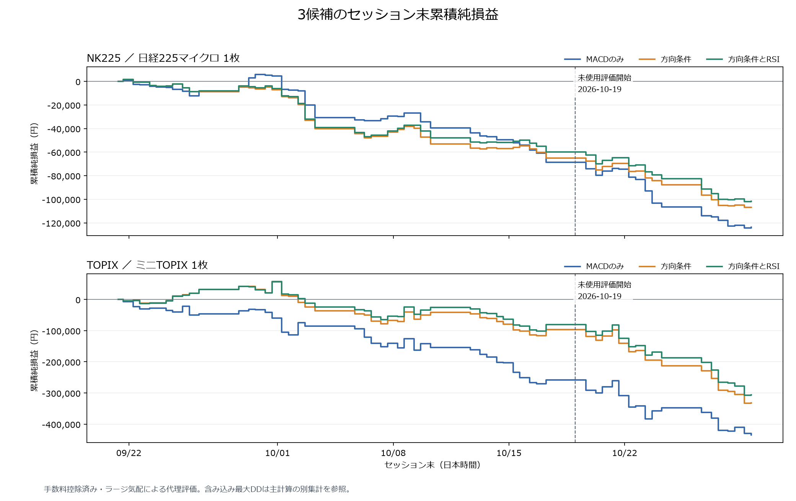

# 試行00001：MACDと方向条件の比較

状態：完了・採用見送り。実施日：2026-10-30。

**今回の3候補は、両指数とも手数料前から赤字だった。方向条件による損失縮小は全期間では見られたが、未使用期間のTOPIXでは悪化した。安定した改善や、自動売買へ採用する根拠は得られなかった。**

金額は、NK225マイクロ1枚・ミニTOPIX1枚をラージの気配で売買したと仮定した代理損益。実行商品の板による約定実績ではない。両商品1枚は同じリスク量ではなく、各候補も独立した比較なので、損益を合算して一つの運用成績にしない。

## 1. 仮説と事前固定

[教科書C01](../../docs/technical-analysis/組み合わせ/移動平均線とMACDとRSI.md)から、次を検証した。

> 確定5分足のMACD交差へEMA60の方向条件を加えると、無取引も含む1セッション当たりの費用後損益が改善するか。RSI14の50条件を追加した効果はあるか。

損益計算前に[計画](計画.md)と[条件・入力一覧](条件.json)を保存し、3候補と期間境界を固定した。パラメータ最適化や、結果を見てからの期間の選び直しは行っていない。計算実装の整合確認には合成データと開発期間の初日を用いた。

## 2. 対象と計算方法

| 項目 | 採用した条件 |
| --- | --- |
| 入力 | NK225・TOPIX各57セッション、2026-09-21_Day〜2026-10-29_Day。各29デイ・28ナイト |
| 期間分割 | 各指数の最初40場を開発、2026-10-19_Day〜10-29_Dayの17場を未使用評価。両指数で同じ境界 |
| 原板 | 圧縮版がある106ファイルはそれを使用、ない8ファイルは生JSONL。選択を入力一覧で固定 |
| 限月 | 全入力の場内で限月コード一意を検査。両指数とも2026年12月限 |
| 分析価格 | CurrentPriceを価格時計・物理行順で集計した確定5分足。既存CSVのOHLCは照合対象 |
| MACD | 12・26・9、すべてEMA。初期値は各期間のSMA |
| 追加指標 | 方向EMA60、RSI14・ATR14はWilder型。全候補に同じウォームアップを要求 |
| 過去足 | 同じ限月の過去確定足を継続利用。無観測の5分枠・限月変更で再初期化し、架空足は作らない |
| 新規条件 | ①MACD交差、②①＋終値とEMA60の位置・傾き一致、③②＋買いRSI>50/売りRSI<50 |
| 通常出口 | 全候補ともMACDの逆交差。追加指標を出口に使わず、入口条件の差を比較 |
| 保護 | シグナル足のATRを固定し、約定価格から不利側へ2ATR。買いは下側・売りは上側へ実行商品の呼値単位に丸める |
| 発動・約定 | 買いの保護はBid、売りはAskで監視。判断・発動から価格時計で1秒以上後の最初の正常板。買いAsk・売りBid、両側数量1以上 |
| 新規停止 | デイ15:25、ナイト翌05:40。新規要求30秒失効、反対交差で未約定新規を取消す |
| 全返済 | デイ15:35・ナイト翌05:50から返済要求。これは完了時刻ではない。ザラバ終了後の架空返済は行わない |
| 競合 | 期限・保護・通常返済・新規の順。既存返済要求の時刻を維持し、重複返済・返済した5分区間の再新規を禁止 |

初期の比較では全手法にEMA60等の準備を要求したため、「MACDのみ」もMACDが計算できた最初の足から常に取引する定義ではない。ウォームアップ後の同じ利用可能期間で比較した。

## 3. 費用

三菱UFJ eスマート証券の2026-10-30確認時の立会料金を、1注文1枚で過去全期間へ固定適用した。税込の表示単価はマイクロ11円・ミニTOPIX41.8円で、注文ごとに1円未満切捨てとされるため、モデルでは片道11円・41円を使用した。[公式料金](https://kabu.com/item/fop/f_detail.html)、[TOPIXの補足](https://kabu.com/item/fop/f_detail/topix.html)

これは利用する証券会社や過去の請求額を確定したものではなく、今回の費用仮定。Bid/Askに含まれるスプレッドは再度控除していない。費用増ケースは、**同じ約定時刻・数量を固定**して手数料を2倍にし、片道1実行商品ティックの追加費用を課した。別の価格で保護を再計算した経路の再現ではない。

## 4. 全期間の結果

手数料後。DDは正常板で観測した含み損益と支払済費用を含め、セッション間も累積して測った最大ドローダウン。欠測区間の真の極値を保証しない。

| 商品 | 入口条件 | 取引数 | 純損益 | 勝率 | PF | 最大DD | 費用増の純損益 |
| --- | --- | ---: | ---: | ---: | ---: | ---: | ---: |
| NK225マイクロ | MACDのみ | 305 | −123,610円 | 24.59% | 0.538 | 136,922円 | −160,820円 |
| NK225マイクロ | 方向条件 | 240 | −106,780円 | 24.58% | 0.487 | 112,672円 | −136,060円 |
| NK225マイクロ | 方向条件＋RSI | 237 | −101,714円 | 24.89% | 0.499 | 107,606円 | −130,628円 |
| ミニTOPIX | MACDのみ | 295 | −434,690円 | 24.41% | 0.587 | 462,067円 | −606,380円 |
| ミニTOPIX | 方向条件 | 237 | −331,934円 | 26.16% | 0.594 | 408,490円 | −469,868円 |
| ミニTOPIX | 方向条件＋RSI | 234 | −305,688円 | 26.50% | 0.614 | 381,244円 | −441,876円 |

手数料前でも、NK225は順に−116,900円・−101,500円・−96,500円、TOPIXは−410,500円・−312,500円・−286,500円。今回の赤字を手数料だけの問題とは説明できない。

## 5. 未使用評価期間の結果

各指数17セッション。無取引の場も平均の分母に含む。

| 商品 | 入口条件 | 取引数 | 純損益 | 平均セッション損益 | PF | 最大DD |
| --- | --- | ---: | ---: | ---: | ---: | ---: |
| NK225マイクロ | MACDのみ | 96 | −55,112円 | −3,241.9円 | 0.442 | 61,490円 |
| NK225マイクロ | 方向条件 | 77 | −41,794円 | −2,458.5円 | 0.440 | 46,108円 |
| NK225マイクロ | 方向条件＋RSI | 77 | −41,794円 | −2,458.5円 | 0.440 | 46,108円 |
| ミニTOPIX | MACDのみ | 110 | −176,020円 | −10,354.1円 | 0.606 | 217,798円 |
| ミニTOPIX | 方向条件 | 92 | −236,044円 | −13,884.9円 | 0.411 | 264,732円 |
| ミニTOPIX | 方向条件＋RSI | 91 | −225,462円 | −13,262.5円 | 0.422 | 254,150円 |

方向条件の追加による対応差は、NK225では合計＋13,318円、TOPIXでは−60,024円。1場平均はそれぞれ＋783.4円・−3,530.8円で、改善方向が揃わなかった。

RSI追加はNK225の評価期間では取引を一件も変えなかった。TOPIXでは1件だけ減り＋10,582円となったが、1件による差から一般的な追加効果は結論できない。全期間を見て最も損失が小さい候補を採用することもしない。



図は確定損益のセッション末の推移であり、含み込み最大DDの計算用系列ではない。数値の詳細は[候補比較](候補比較.csv)、[セッション集計](セッション集計.csv)、[取引集計](取引集計.csv)、[対応差](対応差.csv)を参照。さらに[時間帯別](内訳_時間帯.csv)、[売買別](内訳_売買.csv)、[対応差の集計](対応差集計.csv)を保存した。

## 6. データ品質と結果の限界

全114入力・16,793,047原行を読み、採用した展開内容のSHA256とサイズを[入力台帳](データ品質と入力台帳.json)へ保存した。時計欠測はNK225 36,989行・TOPIX 31,751行、後退は両方0。場外時計は389行・400行を除外した。正常な約定板として使えなかった場内行は14,723行・19,462行。

価格時計が同じ行はNK225 8,302,278行・TOPIX 7,771,192行と多い。**CurrentPriceTimeは最終価格の時計で、板の受信時計ではない。** 1価格時計秒待つ条件は、実際の通信・注文遅延の測定ではない。新規のモデル待ち時間は両指数とも中央値3秒、最大28秒・29秒。返済の最大待ち時間は192秒・254秒だった。この約定仮定は結果を左右し得る。

無観測の5分枠はNK225 21枠、TOPIX 16枠で、無取引と収集欠落は区別できない。該当箇所で指標を再初期化した。前セッションの継続を含む有効指標足は6,056本・6,132本。欠損を前値で埋めた手法の成績ではない。

原板から作った足13,457本を既存5分CSVと照合し、13,346本でOHLCが一致、111本で差があった。CSVには別に15本多く、15:40始端の足を含む。代表3場の12不一致足を調べたところ、全て終値だけの差だったが、原因の確定や全111件への外挿はしていない。既存CSVの生成仕様は未確定のため、結果に合わせてCSVへ切り替えず、今回は原板からの定義を一貫して使った。[足の照合](足の照合.csv)、[差分の確認](足差分の確認.md)

ラージの価格刻み・スプレッドは小口商品のものと同一ではない。この結果を、実際のmicro・mini注文の約定保証や、テクニカル分析一般の有効・無効の証明にしない。対象期間も短く、同じ限月・相関する二指数の結果である。

## 7. 持ち越し・会計・表示の確認

- 3候補×2指数×57場＝342資源について、モデルの終了建玉・終了未約定はいずれも0。
- 1,548完結取引・3,096約定片を[独立台帳照合](台帳照合結果.json)で再構成し、全342資源でセッション集計の値幅損益・費用・純損益に一致。
- 合成データ22件の検証で、初期化、同時計の約定禁止、Bid/Ask方向、保護価格の飛越え、期限・未解消、注文失効、欠枠、DDを確認。
- Viewerの代表4資源で、画像・数値の最終損益がCSVと一致し、終了建玉・含みは0。画像・数値の指紋も一致した。[Viewer照合](Viewer照合.json)

独立台帳の監査は原板を再読せず、約定からの会計を検査したもの。全取引の執行仮定や含みDDまで独立に証明したものではない。

代表図は、未使用期間の「方向条件」から指数ごとの最大利益場・最大損失場を機械的に選んだ。全期間の代表性を保証する選択ではない。

| 資源 | 純損益 | Viewer画像 |
| --- | ---: | --- |
| NK225・2026-10-20デイ | ＋2,834円 | [利益場](図/NK225_2026-10-20_Day_最大利益場.png) |
| NK225・2026-10-26デイ | −8,732円 | [損失場](図/NK225_2026-10-26_Day_最大損失場.png) |
| TOPIX・2026-10-20ナイト | ＋19,426円 | [利益場](図/TOPIX_2026-10-20_Night_最大利益場.png) |
| TOPIX・2026-10-21デイ | −43,492円 | [損失場](図/TOPIX_2026-10-21_Day_最大損失場.png) |

## 8. 再現とViewerでの閲覧

Python 3.14.3で実行。主計算・検証・台帳照合は標準ライブラリで動作し、今回の主計算では高速読取にorjson 3.13.0を使用した。orjsonがなければ標準jsonへ切り替わる。図の再生成はmatplotlib 3.11.2を使用し、Windowsの既存の明瞭フォントを参照した。

```powershell
python -X utf8 "study/00001_MACDと方向条件の比較/検証.py"
python -X utf8 "study/00001_MACDと方向条件の比較/再現.py"
python -X utf8 "study/00001_MACDと方向条件の比較/台帳照合.py" --output "study/00001_MACDと方向条件の比較/台帳照合結果.json"
python -X utf8 "study/00001_MACDと方向条件の比較/内訳と図.py"
```

入力一覧は固定済みで、後から増えたセッションを自動追加しない。再実行時は元の原板を同じ相対配置で参照し、入力サイズと既存台帳の内容ハッシュを確認する。生JSONLを使う8入力もあるため、データのGitコミットだけでなく一覧にある原板の実物が必要。[実行情報](実行情報.json)にコード・条件のSHA256、使用版を記録した。

Viewerではdata_rootを `../JP_OSE_Data/future` の実際の絶対位置、resource_rootを本リポジトリへ合わせ、`study/00001_MACDと方向条件の比較/一覧.resources.json` をサーバー上の一覧として開く。[設定と形式](../../docs/データと閲覧形式.md)

原板・全ティック指標・全時点会計の複製は保存していない。原板への参照、約定、少量の判断記録、集計、代表図から再現する。

## 9. 次の問い

今回のMACD追随をそのまま採用せず、次は入口と出口を分けて診断する。例えば「方向条件で除外した取引が、どの場・売買方向で損失縮小/拡大へ寄与したか」「逆交差まで待つ間にMFEをどれだけ返しているか」「価格時計による待機と実行商品のスプレッドで成績がどの程度変わるか」が候補になる。

これらは次の仮説であり、今回の結果へ後付けして改善済みとはしない。一度閲覧した評価期間を、次の変更に対して未使用と呼ばない。新たな番号と追加の未観測期間で検証する。
