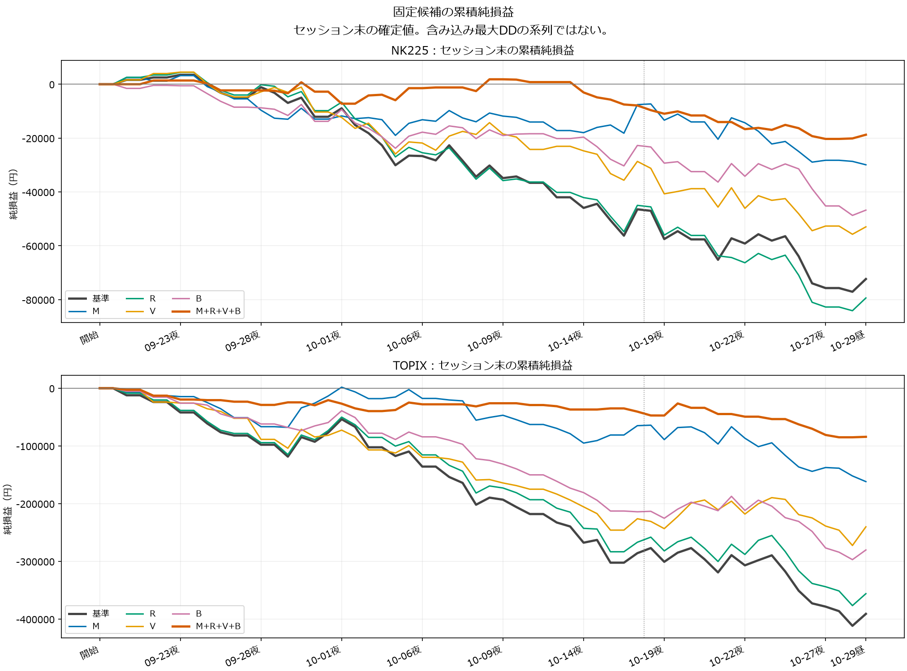

# 試行00002：複数時間足と四系統の要因比較

実行日：2026-10-31。状態：完了・全候補採用見送り。

**両指数とも16候補すべてが、手数料控除前の約定価格差損益も赤字だった。** この価格差にはBBOスプレッドが含まれる。8文脈の全期間平均では上位足の方向一致・数量・低ボラの追加で損失額は小さくなったが、取引数も減った。RSI非過熱の追加効果は一貫せず、全条件を重ねた候補も最良ではなかった。無取引の0円に対する優位性は確認できていない。

## 仮説・入力・条件

[計画](計画.md)・[条件](条件.json)を損益計算前に固定した。5分EMA方向内の直前6本価格帯突破を共通入口とし、次の四条件を各オン・オフにする16通りを比較した。

- **M**：15・30分でも終値とEMA20の位置・傾きが5分の方向と一致。
- **R**：5・15分RSI14が買い70未満・売り30超。非過熱だけで50条件は加えない。
- **V**：観測数量が同セッション直前20足平均の1.2倍以上。
- **B**：5分ATR14/終値が、その前60有効足の同比率の中央値以下。

出口は5分終値のEMA反対側、固定2ATR保護、期限返済で共通。数量基準と全指標の準備を全候補で揃えたため、各場の最初の約105分以上は入口対象外。正常板と期限以外のスプレッド上限フィルターは加えていない。

対象はNK225・TOPIX各57場、2026-09-21_Day〜2026-10-29_Day。旧試行で見た期間なので、全て再利用探索である。前半40場・後半17場という分割は未使用評価ではない。追加3場はこの16候補には評価していない。

[入力台帳](入力台帳.json)に原板への参照、サイズ、展開内容SHA256、キャッシュSHA256を凍結。旧114入力の展開内容SHA256は00001と全件一致した。板を複製せず、同時計で完全に同一の状態だけを省略した作業キャッシュを用いた。[数量・生成コードの監査](../../docs/議論/入力と数量の監査.md)

NK225micro1枚（倍率10円・刻み5・片道11円）、TOPIXmini1枚（倍率1000円・刻み0.25・片道41円）の固定費用。ラージBBOで判断後1価格時計秒以上待つ代理執行であり、小口商品の実約定ではない。費用増は同じ取引経路で手数料2倍＋片道1実行商品ティックを追加した費用感度である。詳細と料率出典は計画を参照。

## 全16候補の探索結果

金額は手数料後、各商品1枚。二商品は倍率が違うため、円損益を合算して順位を決めない。

| 入口条件 | NK225取引数 | NK225純損益 | TOPIX取引数 | TOPIX純損益 |
| --- | ---: | ---: | ---: | ---: |
| 基準 | 288 | −72,336円 | 286 | −390,952円 |
| B | 198 | −46,756円 | 204 | −280,228円 |
| V | 180 | −52,960円 | 172 | −240,104円 |
| V＋B | 116 | −27,952円 | 111 | −117,602円 |
| R | 276 | −79,372円 | 280 | −355,960円 |
| R＋B | 187 | −63,614円 | 199 | −271,318円 |
| R＋V | 159 | −61,798円 | 161 | −222,702円 |
| R＋V＋B | 100 | −36,000円 | 101 | −109,782円 |
| M | 169 | −29,918円 | 156 | −161,792円 |
| M＋B | 116 | −11,952円 | 106 | −123,192円 |
| M＋V | 115 | −30,530円 | 97 | −85,454円 |
| M＋V＋B | 72 | −8,984円 | 62 | −62,584円 |
| M＋R | 153 | −33,766円 | 146 | −139,972円 |
| M＋R＋B | 105 | −29,310円 | 97 | −128,954円 |
| M＋R＋V | 91 | −34,902円 | 85 | −86,470円 |
| M＋R＋V＋B | 57 | −18,754円 | 51 | −84,182円 |

全候補の手数料控除前、費用増、PF、勝率、含み込みDD、前後半は[候補比較](候補比較.csv)へ保存。[セッション集計](セッション集計.csv)・[取引集計](取引集計.csv)から各場・取引へ戻れる。



図の6候補は成績で選ばず、基準・単独四因子・全因子を固定して表示。セッション末累積であり、含み込み最大DDの計算系列ではない。

## 因子をどう読むか

他の三因子が同じ8組ずつで追加の効果を比較した。下表は8文脈の場平均差をさらに平均した探索記述。独立8実験の平均ではない。

| 追加因子 | NK225の場損益差平均 | TOPIXの場損益差平均 | 全対象で改善した文脈数 NK/TOP |
| --- | ---: | ---: | ---: |
| M | ＋532.18円 | ＋2,447.47円 | 8/8・8/8 |
| R | −166.95円 | ＋137.21円 | 0/8・5/8 |
| V | ＋208.65円 | ＋1,849.75円 | 6/8・8/8 |
| B | ＋333.90円 | ＋1,108.69円 | 8/8・8/8 |

Mも安定した利益条件とはいえない。TOPIXでMの平均追加効果は前半＋3,883.91円/場から後半−932.38円/場へ反転した。全対象だけで有力と結論しない。[因子主効果](因子主効果.csv)・[文脈別の効果](因子効果.csv)・[場ごとの対応差](対応差.csv)

M＋V＋BにRをさらに加えると、NK225は9,770円、TOPIXは21,598円悪化。RSIが高い・低いことを無条件に避けると、追随に必要な動きまで除く可能性があるが、今回その心理や因果を証明したものではない。

共通の発動可能数はNK225858本、TOPIX870本。M＋V＋Bは135本/119本（15.73%/13.68%）を許可し、全四因子は84本/76本（9.79%/8.74%）だった。[発動条件内訳](発動条件内訳.csv)。保有・待機中は実際に入れないため、許可数と取引数は違う。

条件追加で取引経路も変わる。損失を防いだ取引だけを抜き出す解釈や、複数足の一致を独立した票とする解釈はしない。利益や継続確率自体を実証した比較でもない。

## データ品質・監査・閲覧

原板から作った5分足はNK2256,726本、TOPIX6,731本。共通指標・数量基準を満たす足は4,537本/4,616本、欠けた5分区間は21/16。欠足時は指標と数量基準を再取得し、遅れて確定した古い足を発動に使わない。[品質集計](品質集計.json)

場内数量時計は価格時計と全件一致したが、独立した受信時刻・全約定列はない。数量基準有効は通信欠落がない保証ではなく、観測差分量の比較である。平均出来高の参照が直近100分なので、時刻による活動量変化とも混ざる。対象は短期間の同限月で、二指数の相関、初期時間帯の除外、小口商品の代理執行という限界がある。

- 全1,824資源の終了建玉・未約定は0。
- 4,696完結取引・9,392約定片を、再生コードを読み込まないDecimal会計で照合。全約定の原行・BBO・価格時計もキャッシュと一致した。[台帳照合](台帳照合結果.json)
- 共通の合成検証31件が成功。集計49,752検査は不一致0。[集計照合](集計照合結果.json)
- Viewer代表4資源と、混在約定中で対象手法だけ無取引の1資源について、最終損益・保有・約定帰属・指紋を照合した。[Viewer照合](Viewer照合.json)

含みDD・入口・追尾等の発動時点を独立会計が丸ごと再現した意味ではない。詳細な監査範囲は各JSONを参照。

Viewerでは `study/00002_複数時間足と四系統の要因比較/一覧.resources.json` を開く。各場の約定ファイルを候補間で共有し、`entry_method_id` で新規に帰属する建玉を分離する。[一覧](一覧.resources.json)

## 次の試行と再現

M＋V＋Bの中で1ATR以上順行後に損失となった取引はNK22519件、TOPIX14件だった。この診断から、[00003：決済方法の比較](../00003_四系統の入口と決済方法の比較/README.md)へ進んだ。M＋V＋Bの選択自体はこの探索を見た選択であり、未使用評価で最良と確認したものではない。

```powershell
python -X utf8 "scripts/複合検証/キャッシュ復元.py" --manifest "study/00002_複数時間足と四系統の要因比較/入力台帳.json"
python -X utf8 "scripts/複合検証/検証.py"
python -X utf8 "scripts/複合検証/再生.py" --study "study/00002_複数時間足と四系統の要因比較" --phase 探索
python -X utf8 "scripts/複合検証/台帳検証.py" --study "study/00002_複数時間足と四系統の要因比較" --cache-check
python -X utf8 "scripts/複合検証/集計.py" --study "study/00002_複数時間足と四系統の要因比較"
```

依存・キャッシュ復元は[共通コード](../../scripts/複合検証/README.md)、コード・入力・設定のSHA256は[実行情報](実行情報.json)を参照。最終コードへ再実行して、損益・取引集計・セッション集計のSHA256が初回実行と不変であることも確認した。別作業フォルダへ1場のキャッシュを実際に再生成し、同じSHA256になることを[再現性確認](再現性確認.json)へ記録した。
