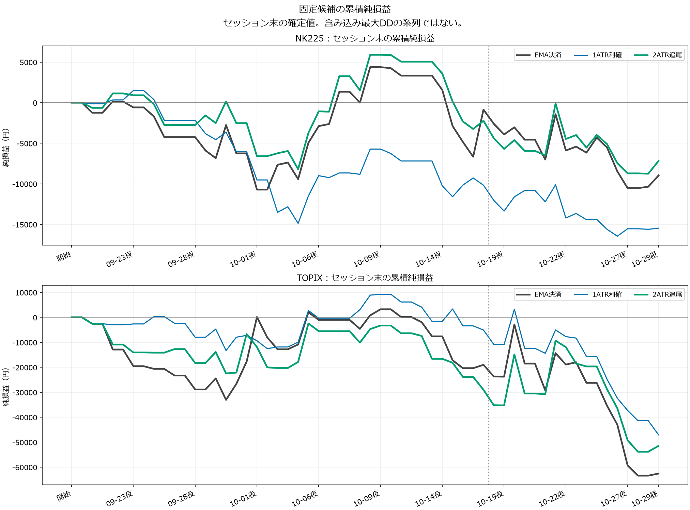
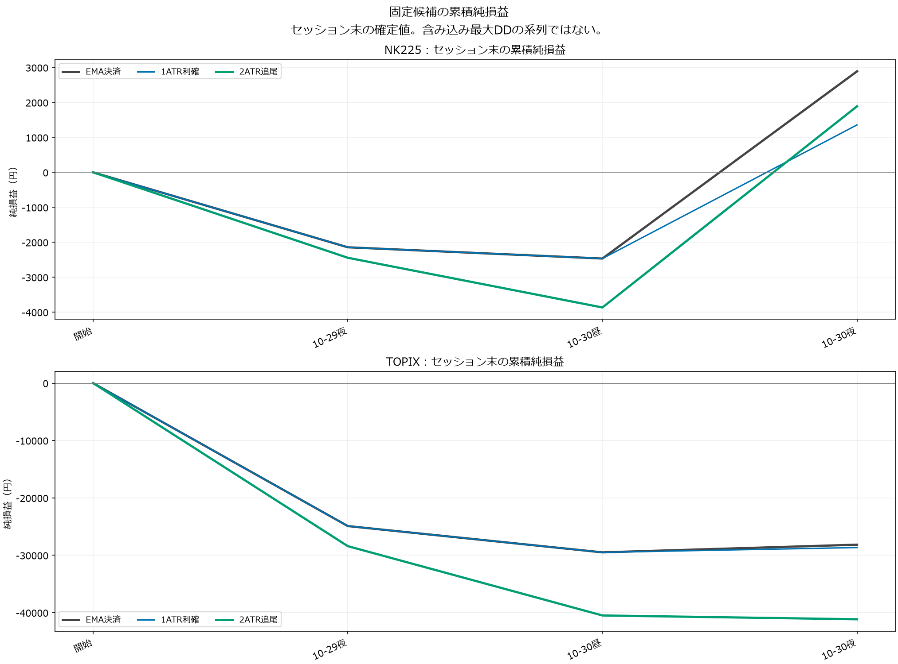

# 試行00003：四系統の入口と決済方法の比較

実行日：2026-10-31。状態：探索・追加確認完了、全候補採用見送り。

**入口を固定して出口を変えても、探索期間では全候補が手数料控除前の約定価格差損益も赤字だった。** この価格差にはBBOスプレッドが含まれる。1ATR利確はTOPIXで損失縮小、NK225で悪化。追加3場の主比較でも1ATR利確は両指数でEMA決済以下だった。

## 仮説・入力・条件

[00002](../00002_複数時間足と四系統の要因比較/README.md)でM＋V＋Bの損失額が両指数で最小だったため、この入口を探索結果を見て選択した。1ATR以上順行後に負けた取引19件/14件という診断から、利益の戻しを減らす出口を調べた。MFEの価格で必ず約定したとする計算へは置き換えない。

四系統の候補から選んだ入口であり、この試行ではR（RSI非過熱）を許可条件に使わない。RSIを含む共通の準備条件は比較のため維持した。

[計画](計画.md)・[条件](条件.json)を先に固定し、同じ入力で次の三候補を逐次再生した。

| 出口 | 判断 | 非常時保護 |
| --- | --- | --- |
| EMA決済 | 5分終値がEMA20の反対側 | 新規から固定2ATR |
| 1ATR利確 | EMA決済に加え、有利側1×入口ATRへ返済気配が到達したら成行返済要求 | 同じ固定2ATR |
| 2ATR追尾 | EMA出口を使わず、確定5分終値と当足ATRから保護を有利側へだけ更新 | 初期2ATR、以降終値から2ATRの追尾候補 |

全候補共通で期限返済、最大1枚、実行商品と費用は00002と同じ。利確・保護は要求から1価格時計秒以上後の正常なラージBBOで成立させる。目標線に触れた瞬間の指値約定ではなく、その後の戻りや飛越えを含む代理執行。追尾線は形成中の気配で動かさない。

入力は[参照ファイル](入力台帳.json)から00002の固定台帳をSHA256付きで共用。原板・中間足・全時点指標は複製していない。旧57場はすべて再利用探索。追加3場は条件と数値コードの[固定記録](追加確認前の固定.json)を残した後に一度評価した。

## 探索57場の結果

各指数57場、金額は各商品1枚・手数料後。費用増は手数料2倍＋片道1実行商品ティック費用。

| 商品 | 出口 | 取引数 | 純損益 | 費用増純損益 | PF | 含み込み最大DD |
| --- | --- | ---: | ---: | ---: | ---: | ---: |
| NK225micro | EMA決済 | 72 | −8,984円 | −17,768円 | 0.843 | 16,414円 |
| NK225micro | 1ATR利確 | 108 | −15,476円 | −28,652円 | 0.751 | 18,746円 |
| NK225micro | 2ATR追尾 | 72 | −7,184円 | −15,968円 | 0.859 | 16,436円 |
| TOPIXmini | EMA決済 | 62 | −62,584円 | −98,668円 | 0.671 | 89,690円 |
| TOPIXmini | 1ATR利確 | 86 | −47,052円 | −97,104円 | 0.744 | 64,772円 |
| TOPIXmini | 2ATR追尾 | 61 | −51,502円 | −87,004円 | 0.697 | 67,534円 |

1ATR利確の基準差はNK225−6,492円、TOPIX＋15,532円。取引数はそれぞれ36件/24件増え、費用も792円/1,968円増えた。手数料前の差もNK225−5,700円、TOPIX＋17,500円なので、結果の違いは手数料だけでは説明できない。

早く返済すると後続の入口が変わる。00002で見つけた19件/14件の負けだけを救った比較ではなく、入口・出口・建玉経路を含む手法全体の比較である。追尾は全期間の損失額を小さくしても、利益には変わらなかった。



前半40場・後半17場を含む全結果は[候補比較](候補比較.csv)、[セッション集計](セッション集計.csv)、[取引集計](取引集計.csv)へ保存。EMA決済と00002のM＋V＋Bは全114資源の損益・取引数・DD等が一致した。[基準再現照合](基準再現照合.json)

## 固定後の追加3場

2026-10-29_Night、10-30_Day、10-30_Nightを各指数で評価。固定後に入口・閾値・出口を変更していない。

| 商品 | 出口 | 取引数 | 純損益 | 費用増純損益 | EMA決済との差 |
| --- | --- | ---: | ---: | ---: | ---: |
| NK225micro | EMA決済 | 5 | ＋2,890円 | ＋2,280円 | — |
| NK225micro | 1ATR利確 | 11 | ＋1,358円 | ＋16円 | −1,532円 |
| NK225micro | 2ATR追尾 | 5 | ＋1,890円 | ＋1,280円 | −1,000円 |
| TOPIXmini | EMA決済 | 8 | −28,156円 | −32,812円 | — |
| TOPIXmini | 1ATR利確 | 8 | −28,656円 | −33,312円 | −500円 |
| TOPIXmini | 2ATR追尾 | 8 | −41,156円 | −45,812円 | −13,000円 |

主比較の1ATR利確は両指数で基準以下。NK225の追加分の利益は最後の10/30ナイトに依存し、先の2場は損失。3場・少数取引で安定性は判断できない。[追加の候補比較](追加確認/候補比較.csv)・[場別結果](追加確認/セッション集計.csv)



探索前半・後半の各指数が正、各指数30取引以上、費用増も正、未解消0という事前の採用条件を全候補が満たさなかった。追加3場だけの良い数字で採用へ変えず、全て見送る。この3場は今後の条件変更に対して未使用とは呼ばない。

## 監査・Viewer・限界

- 共通の合成検証31件が成功。利確後の戻り価格、売買両方向、目標の呼値丸め、追尾の後退禁止、形成中の追尾禁止を含む。
- 探索342資源・461取引・922約定、追加18資源・45取引・90約定をDecimalで独立会計。全約定の原板行・正常BBO・時計も一致。[探索の台帳監査](台帳照合結果.json)・[追加の台帳監査](追加確認/台帳照合結果.json)
- 集計の探索11,006検査、追加1,098検査は不一致0。[探索](集計照合結果.json)・[追加](追加確認/集計照合結果.json)
- 全資源の終了建玉・未約定は0。含みDDや入口・追尾・利確の最初の発動時点を独立台帳が再現した意味ではない。

Viewerでは探索の[一覧](一覧.resources.json)、追加の[一覧](追加確認/一覧.resources.json)を使う。混在約定を新規の手法へ帰属させて分離する。

追加確認の代表2場は1ATR利確の各指数で最大絶対損益の場を機械選択した。他の二出口も同場の数値を照合した。[Viewer照合](追加確認/Viewer照合.json)

| 1ATR利確の代表場 | 純損益 | Viewer画像 |
| --- | ---: | --- |
| NK225・10/30ナイト | ＋3,824円 | [価格・建玉・損益](追加確認/図/NK225_最大絶対損益場_2026-10-30_Night.png) |
| TOPIX・10/29ナイト | −24,910円 | [価格・建玉・損益](追加確認/図/TOPIX_最大絶対損益場_2026-10-29_Night.png) |

限界は、探索結果を見た入口選択と出口仮説、短い同限月の期間、二指数の相関、最初の約105分以上を除く共通母集団、価格時計による代理執行、小口実行板の不足。今回の結果は「早い利確は常に悪い」「四系統の複合分析に価値がない」という一般化を支えない。

## 再現と次の問い

```powershell
python -X utf8 "scripts/複合検証/キャッシュ復元.py" --manifest "study/00003_四系統の入口と決済方法の比較/入力台帳.json"
python -X utf8 "scripts/複合検証/検証.py"
python -X utf8 "scripts/複合検証/再生.py" --study "study/00003_四系統の入口と決済方法の比較" --phase 探索
python -X utf8 "scripts/複合検証/再生.py" --study "study/00003_四系統の入口と決済方法の比較" --phase 追加確認
python -X utf8 "scripts/複合検証/台帳検証.py" --study "study/00003_四系統の入口と決済方法の比較" --cache-check
python -X utf8 "scripts/複合検証/台帳検証.py" --study "study/00003_四系統の入口と決済方法の比較/追加確認" --cache-check
python -X utf8 "scripts/複合検証/集計.py" --study "study/00003_四系統の入口と決済方法の比較"
python -X utf8 "scripts/複合検証/集計.py" --study "study/00003_四系統の入口と決済方法の比較/追加確認"
python -X utf8 "scripts/複合検証/Viewer照合.py" --study-root "study/00003_四系統の入口と決済方法の比較/追加確認" --method 1ATR利確 --selection max-absolute
```

依存・保存方針は[共通コード](../../scripts/複合検証/README.md)、実行版は[探索の実行情報](実行情報.json)と[追加の実行情報](追加確認/実行情報.json)。追加確認は固定記録のハッシュ一致を要求するので、コード変更後に同じ未見評価と称して再実行しない。

次は突破を追う前提、現在の低ボラと「過去収縮→発動時拡大」の違い、RSIの非過熱と回復・持続の違いが候補。ただし今回は未検証で、条件変更は次番号と新たな評価期間へ送る。[議論](../../docs/議論/複合判断の候補と検証方針.md)
