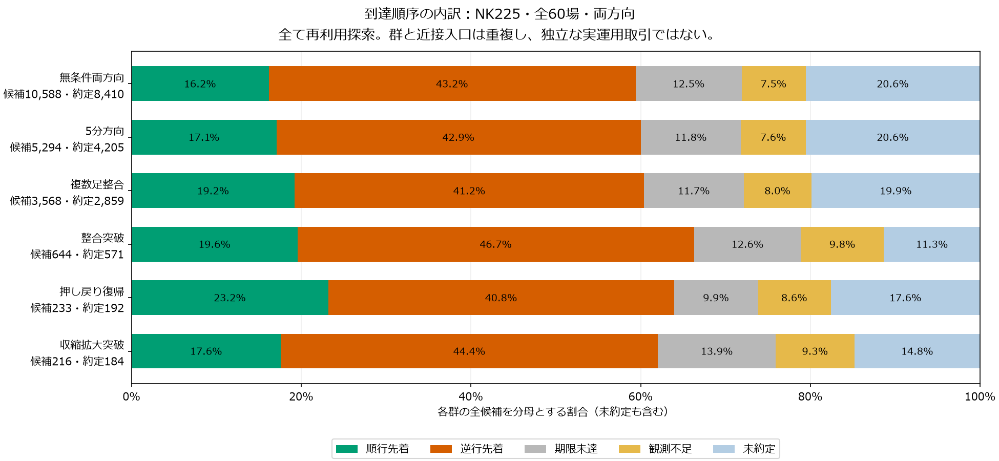
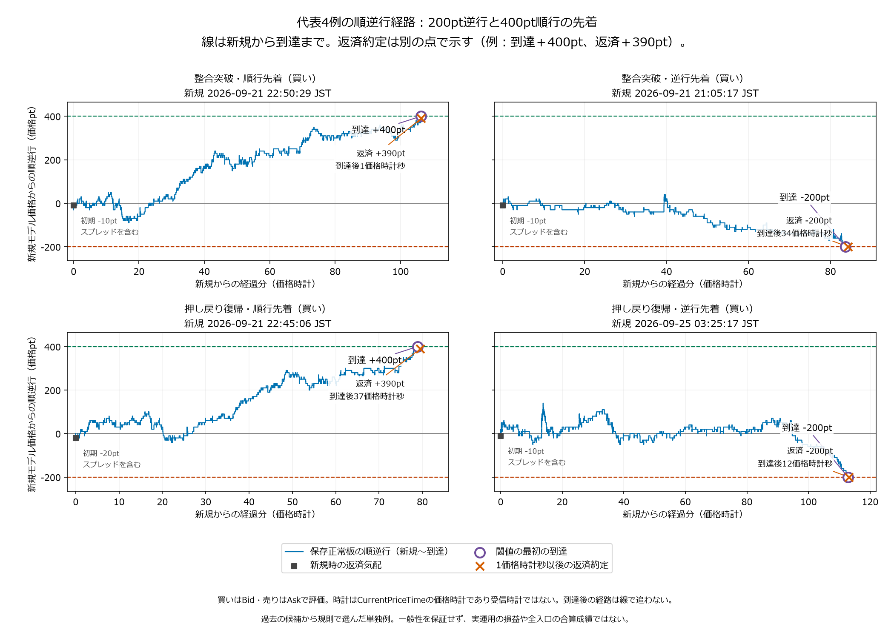

# 試行00004：逆行200ptと順行400ptの入口分析

実行日：2026-11-01。状態：入口分析・独立照合完了。安定した入口条件の採用には至らず。

**入口は「どちら向きか」に加え、「どこまで待ってから入るか」と「400pt動く時間があるか」を分けて考える必要がある。** 今回の六群では押し戻り後の復帰が全体の順行先着割合で上回ったが、期間別の効果は縮小・反転した。この条件なら逆行200ptを避けて400pt取れる、とは結論できない。

NK225のみ。ptは指数価格1円。新規から−200pt以下へ逆行する前に＋400pt以上へ順行したかを、保存された返済気配の原順で評価した。通常の出口や手法全体の損益は比較していない。

## 入口のチャート分析をどう組み立てたか

まず研究候補として残るのは、**上位足の方向の中で押し戻りを待ち、短期足の復帰を確認して入る**形である。買いなら次の順序を使った。

1. 最新の確定15分・30分足が終値>EMA20、EMA20>前値。直前の5分判断時点でも同じ方向だったことを要求する。
2. 前5分足の終値が、その時点のEMA20以下へ押し戻される。
3. 今5分足が確定し、終値が今EMA20を上回って復帰する。この確定を確認した後の正常板で新規する。
4. 新規価格からの逆行200pt・順行400ptの到達順を調べる。売りは不等号と気配方向を反対にする。

これは「上位方向が揃うたびに入る」「高値を突破したから追う」と異なる入口である。復帰前の底や未来の山谷を知っていたことにはしない。今回RSI非過熱・数量増加を入口条件に足してはいない。

心理の説明は、一時的な利益確定後の再開・再参入などの仮説にとどまる。押しがトレンド転換の始まりであれば失敗し、EMAへの復帰も遅れる。一般用法・反例・六群の設計は[議論](../../docs/議論/逆行200ptより先に順行400ptへ届く入口.md)を参照。

## 固定した比較条件

[計画](計画.md)・[条件](条件.json)を到達ラベル計算前に固定した。過去2026-09-21_Day〜10-30_Nightの60場はすべて再利用探索。旧試行で最後に評価した3場も、今回は未使用ではない。[入力台帳の参照](入力台帳.json)

六群は、無条件両方向、5分方向、5/15/30分の方向整合、整合＋直前6本高安の突破、押し戻り復帰、整合＋過去収縮からの当足拡大突破。六つの別の約定経路を作らず、同時点・同方向の入口を一回ラベル化して群で共用した。

全群で共通指標の準備を要求。15・30分は当場の完全確定足が一つ以上あり、前5分時点の上位足も当場で有効であることが必要。30分EMA20の初期化や欠足による再取得もあり、候補が発生したのは60場中50場だった。数量の直前20本は共通準備にせず、数量不足でも価格だけの入口は残した。

確認後1価格時計秒以上、30秒以内の最初の正常ラージBBOで買いAsk・売りBidを仮新規価格とする。足確定の確認が30秒を超えた場合は未約定。新規はデイ15:25/翌05:40未満、評価期限は15:35/翌05:50まで。期限端点は含める。小口商品の実板・受信遅延・実注文の再現ではない。

- **順行先着**：買いはBid>=新規価格+400、売りはAsk<=新規価格−400が先。
- **逆行先着**：買いはBid<=新規価格−200、売りはAsk>=新規価格+200が先。
- **期限未達**：上記どちらにも届かず、期限まで観測できた。
- **観測不足**：未決着中に正常板価格時計が300秒超空いた、または期限前に入力が終わった。
- **未約定**：新規の確認・待機・期限条件を満たさなかった。

新規板のスプレッドも逆行に含める。＋400先着後に−200へ戻ったとしても成功は取り消さない。逆に、−200が先で後に＋400へ届いたものは成功に数えない。OHLCだけで先着を推定していない。保存観測の間の全経路まで保証するものではない。

## 全期間の比較結果

率は**順行先着/全約定候補**。期限未達・観測不足を成功に数えず分母へ含めた確認割合であり、信頼区間の下限や将来の成功確率ではない。未約定は下表の約定候補数から除き、別に保存した。

| 入口群 | 約定候補数 | ＋400先着 | −200先着 | 期限未達 | 観測不足 | ＋400確認割合 |
| --- | ---: | ---: | ---: | ---: | ---: | ---: |
| 無条件両方向 | 8,410 | 1,711 | 4,579 | 1,323 | 797 | 20.3% |
| 5分方向 | 4,205 | 904 | 2,272 | 626 | 403 | 21.5% |
| 複数足整合 | 2,859 | 686 | 1,469 | 419 | 285 | 24.0% |
| 整合突破 | 571 | 126 | 301 | 81 | 63 | 22.1% |
| 押し戻り復帰 | 192 | 54 | 95 | 23 | 20 | 28.1% |
| 収縮拡大突破 | 184 | 38 | 96 | 30 | 20 | 20.7% |

不明を除く「順行/判定可能」では復帰は54/(54+95+23)=31.4%。期限と不明を両方除くと54/(54+95)=36.2%になるが、＋400先着を確認できなかった候補も分母から落としてしまう。この率だけを良い入口の証拠にしない。[全率・期間・売買別の結果](候補比較.csv)・[全イベント](入口事例.csv)



図は未約定を含む**全候補**が分母で、表の全約定分母とは異なる。復帰の緑部分は54/233=23.2%、表は54/192=28.1%。

## 時刻・方向・期間の違いをどう読むか

同じ時刻の買い・売りを半々で選んだ対照も作った。時間余地やその時の変動幅が違う入口同士だけを比べないための記述であり、実際の無作為化試験ではない。

| 入口群 | 選んだ方向の確認割合 | 同時刻の買売半々対照 | 差 |
| --- | ---: | ---: | ---: |
| 5分方向 | 21.5% | 20.3% | ＋1.2ポイント |
| 複数足整合 | 24.0% | 20.7% | ＋3.3ポイント |
| 整合突破 | 22.1% | 20.7% | ＋1.4ポイント |
| 押し戻り復帰 | 28.1% | 22.7% | ＋5.5ポイント |
| 収縮拡大突破 | 20.7% | 19.6% | ＋1.1ポイント |

復帰の同時刻差は前半40場＋9.65ポイント、後半17場＋0.83ポイント、既使用末尾3場−5.56ポイントへ変わった。末尾では18件中3件（16.7%）で、全期間の順位から安定性を判断できない。[同時刻方向比較](同時刻方向比較.csv)・[場別集計](場別集計.csv)

方向別にも偏りがある。整合突破は買い41/291=14.1%、売り85/280=30.4%。復帰は買い31/114=27.2%、売り23/78=29.5%。当該相場の方向と入口の働きを区別し、売り一般が有利とは結論しない。

時間余地は大きな論点だった。復帰の固定層別では、期限まで180分以上が51/141=36.2%、60〜180分未満が3/42=7.1%、60分未満は0/9。これはあらかじめ決めた層の記述であり、「180分以上」を結果後に新しい採用条件へ加えて再検証した意味ではない。

400/ATR、方向側RSI、観測数量、デイ/ナイトも同じ境界で全群を比較した。[固定層別](固定層別.csv)。残り時間・変動幅と条件群が関連するので、条件の効果や心理の因果を識別したものではない。

## 成功例と失敗例をチャートで見る

整合突破・復帰それぞれで、順行先着・逆行先着の時刻順最初の事例を機械選択した。各例は一建玉・二約定の単独シナリオで、独立イベントを一括した運用結果ではない。

| 入口群・ラベル | 事例 | Viewer画像 |
| --- | --- | --- |
| 整合突破・順行先着 | 09/21ナイト、買い | [価格・建玉・経路](図/整合突破_順行先着_NK225_2026-09-21_Night_069_1.png) |
| 整合突破・逆行先着 | 09/21ナイト、買い | [価格・建玉・経路](図/整合突破_逆行先着_NK225_2026-09-21_Night_048_1.png) |
| 押し戻り復帰・順行先着 | 09/21ナイト、買い | [価格・建玉・経路](図/押し戻り復帰_順行先着_NK225_2026-09-21_Night_068_1.png) |
| 押し戻り復帰・逆行先着 | 09/24ナイト、買い | [価格・建玉・経路](図/押し戻り復帰_逆行先着_NK225_2026-09-24_Night_124_1.png) |

順行例は到達時に＋400ptだったが、到達後1価格時計秒以上待った正常板で返済すると両方＋390ptだった。**400pt動いたことと400ptで利確できることは別**。表示はNK225micro1枚の換算・手数料0のgrossで、研究対象の値動きを示す例であり運用損益ではない。[代表事例の時計・価格](代表事例.json)・[シナリオの説明](シナリオ/README.md)



新規から最初の到達までの返済気配を線で表示し、到達点と待機後の返済点を分けた。新規直後のマイナスはスプレッド。成功二例は近接した同じ相場を含み、独立した再現実験二回ではない。

## 検証・品質・再現

- 確定5分足7,119本、共通有効足5,467本、欠5分枠21。新規停止等を適用して10,588入口候補を生成、8,410候補で仮新規が成立。
- 未約定2,178候補は、足確定確認30秒超1,236、30秒内の正常板不足等942。価格時計による待機仮定の影響が大きい。[品質集計](品質集計.json)
- 正常板価格時計300秒超の空白は60場で45箇所、全約定中797候補が観測不足。受信時計がなく、通信欠落か静かな値動きかは断定できない。
- 合成検証22件が成功。到達木6,400区間と素朴検索、240経路×両方向の全出力、同時計順・等号・期限・EOF・空白・確定足等を検査。
- 全10,588イベントを分析本体を読まない直接比較で再検算。285,877項目で不一致0。[独立照合](独立照合結果.json)
- 集計92,194検査は不一致0。ラベル五分類と三つの分母、同時刻の両方向対応を確認。[集計照合](集計照合結果.json)
- Viewer四例の原行・約定・独立会計・最終保有0・数値/画像指紋が一致。[Viewer照合](Viewer照合.json)

同じ時刻・近接時刻の将来経路を多数の候補で共有しており、10,588回の独立試行ではない。共通準備が揃わない場、値動きが疎く待機時間を超える場、全約定列でない原板、ラージによる小口の代理執行という限界を残す。入力・計算コード・条件の版は[実行情報](実行情報.json)を参照。

`判定時計秒/JST`と`所要分`は、先着なら最初の到達時計と経過分、期限未達・観測不足なら最後に採用した正常板と観測追跡分。実際の期限は別列 `期限時計秒` である。

```powershell
python -X utf8 "scripts/複合検証/キャッシュ復元.py" --manifest "study/00004_逆行200ptと順行400ptの入口分析/入力台帳.json"
python -X utf8 "scripts/入口分析/検証.py"
python -X utf8 "scripts/入口分析/分析.py" --study "study/00004_逆行200ptと順行400ptの入口分析"
python -X utf8 "scripts/入口分析/独立照合.py" --study "study/00004_逆行200ptと順行400ptの入口分析"
python -X utf8 "scripts/入口分析/集計.py" --study "study/00004_逆行200ptと順行400ptの入口分析"
python -X utf8 "scripts/入口分析/代表事例.py" --study "study/00004_逆行200ptと順行400ptの入口分析" --viewer
python -X utf8 "scripts/入口分析/経路図.py" --study "study/00004_逆行200ptと順行400ptの入口分析"
```

依存と列の定義は[検証コード](../../scripts/入口分析/README.md)。今回の結果から条件を増やして有効性を確定したことにはせず、次に変更する場合は別番号で、未見の期間を新たに確保する。
