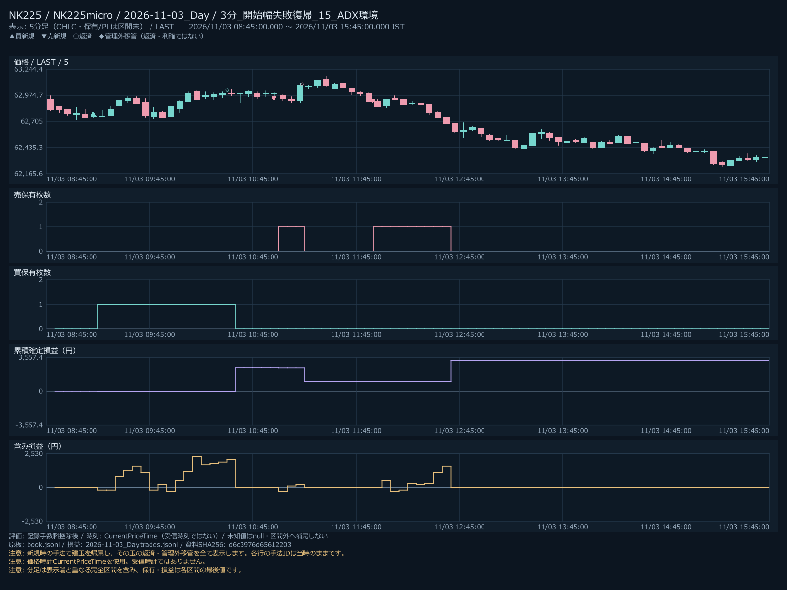

# 試行00007：固定入口の単一建玉と費用感度

実行日2026-11-04。**新4場は8取引、仮定した手数料控除後＋4,524円。ただし条件選択期間は片道10ptの追加費用で赤字となり、入口の70%目標も未達。**

[設定・汎用表・結果](設定と結果.md) / [計画](計画.md) / [条件](条件.json) / [固定と版](運用固定.json) / [前試行00006](../00006_外部手法を1分3分5分で比較/README.md)

## 仮説・入力

00006で固定した「3分足・開始15分高安から外へ抜けた終値の内側復帰・ADX14<20」を一建玉で扱う。重なる入口の抑止、返済の待機と費用を加えた場合にどれだけ成績が変わるかを調べる。新しい入口探索は行わない。

NK225の旧60場（2026/09/21〜10/30）と新4場（11/02〜11/03）。原板・キャッシュは[00006の入力台帳](../00006_外部手法を1分3分5分で比較/入力台帳.json)を参照し複製しない。日付はセッション開始日。TOPIXは今回の対象外。

## 結果

| 期間 | 入力場数 | 完結取引 | 基準の黒字取引率 | R01 基準費用 | R02 片道追加5pt | R03 片道追加10pt | 経路注意 |
| --- | --- | --- | --- | --- | --- | --- | --- |
| 学習09/21〜10/16 | 40 | 44 | 21/44＝47.73% | +19,832円 | +15,432円 | +11,032円 | 2場/2取引 |
| 条件選択10/19〜10/30 | 20 | 32 | 12/32＝37.50% | +3,796円 | +596円 | -2,604円 | 0場/0取引 |
| 後続11/02〜11/03 | 4 | 8 | 4/8＝50.00% | +4,524円 | +3,724円 | +2,924円 | 0場/0取引 |

## 執行・費用の仮定

NK225micro1枚・倍率10円/pt・呼値5ptを仮定し、NK225ラージ板で代理する。片道手数料11円（往復22円）は仮定であり、最新口座費用の確認値ではない。R01〜R03はS01〜S06の同一入口・同一約定に対する費用感度で、別々に最適化した戦略ではない。スプレッドは既にBid/Askの価格差へ含む。R02/R03は完結1取引にそれぞれ100円/200円を追加控除するだけで、約定価格・保護線・次の入口を再計算していない。

新規要求は3分足を次の観測で確認した時点。確認遅延30秒以内、入口の評価期限まで60分以上。要求+1価格時計秒以上・30秒以内、15:25/翌05:40未満の最初の正常板で新規。同じ要求時計・原行の両方向は見送り、一建玉と新規待機中の追加入口は抑止。新規約定価格から有利250pt・不利125ptへ線を固定する。返済も要求後1秒以上を待ち、価格が戻っても成行要求を取り消さない。

各原行では期限・失効、既存待機の約定、新たな閾値返済要求、その原行の入口の順。予定期限と新閾値が同時なら期限を優先し、既に出した返済要求は維持する。指標初期化・足の確認原行は[00006の条件](../00006_外部手法を1分3分5分で比較/条件.json)、運用詳細は[計画](計画.md)・[条件](条件.json)を参照する。

## 不成立と観測品質

| 期間 | 全要求 | 新規約定 | 建玉中抑止 | 待機中抑止 | 確認遅延不可 | 新規失効 | 未解消場 |
| --- | --- | --- | --- | --- | --- | --- | --- |
| 学習09/21〜10/16 | 91 | 44 | 27 | 0 | 15 | 5 | 0 |
| 条件選択10/19〜10/30 | 56 | 32 | 16 | 0 | 5 | 3 | 0 |
| 後続11/02〜11/03 | 14 | 8 | 4 | 0 | 1 | 1 | 0 |

学習の2場2取引には保有経路の300秒超空白がある。旧60場全体の観測損益は基準＋23,628円、追加5pt＋16,028円、追加10pt＋8,428円だが、全体の「確定対象純損益円」は未定義とした。注意なし58場の部分集計を全体の代用にしない。価格時計CurrentPriceTimeは受信時計ではなく、待機は通信・発注遅延の実測ではない。条件選択と新4場はこの経路注意・未解消・期限までのEOF不足が0であるが、microで同価格・同数量が実際に約定する保証にはならない。

学習・条件選択は入口を選ぶために既使用。新4場は2開始日しかなく、00006と同じ標本である。二試行を独立した追試として数えない。基準の黒字取引率は損益>0の完結取引/全完結取引で、00006の「125pt逆行前250pt順行」確認率とは分母・対象・出口が異なる。後続の入口先着は5/12＝41.67%、運用の黒字取引は4/8＝50.00%。どちらも70%達成ではない。

条件選択32取引は基準＋3,796円から片道追加10ptで−2,604円へ変わった。今回の結果は費用に対する余地が小さく、採用確定を支持しない。次は条件を変えず新しい日・相場環境へ適用し、入口先着率、非重複取引、費用、観測品質を並べて確認する。入口や出口の変更は新試行とする。

## 到達幅と約定幅が違う事例

以下は挙動説明のために選んだ例で、代表性や期待収益の推定には使わない。全件は取引集計へ残す。

| 場 | 建玉ID | 方向 | 新規 | 返済 | 理由 | 要求後秒 | 基準純損益 | 経路注意 |
| --- | --- | --- | --- | --- | --- | --- | --- | --- |
| 2026-09-24_Day | 2026-09-24_Day_建玉0001 | 買い | 65850.0 | 65730.0 | 保護 | 6.0 | -1,222円 | False |
| 2026-09-24_Night | 2026-09-24_Night_建玉0003 | 買い | 65210.0 | 65450.0 | 利確 | 47.0 | +2,378円 | False |
| 2026-10-05_Night | 2026-10-05_Night_建玉0002 | 買い | 70080.0 | 70190.0 | 期限 | 13.0 | +1,078円 | True |
| 2026-11-02_Night | 2026-11-02_Night_建玉0004 | 売り | 63210.0 | 62950.0 | 利確 | 27.0 | +2,578円 | False |

TP250/SL125は発動線であり、利確250pt・損失125ptの実約定を約束しない。新4場の11/02ナイト建玉4は返済要求から27秒かかり、観測上は260ptの価格差となった。

## Viewer資料と数値正本

[旧60場の一覧](一覧.resources.json) / [新4場の一覧](追加確認/一覧.resources.json)。市場ルートは `../JP_OSE_Data/future`、約定は各一覧JSON基準の相対パス。Viewerの一覧JSONから開く。表示する約定は基準手数料11円のR01であり、追加費用R02/R03を混ぜない。Viewerは3分足非対応のため、入口の3分条件は設定表と照合し、原板・1分足で約定経路を点検する。

[旧取引集計](取引集計.csv) / [新取引集計](追加確認/取引集計.csv) / [旧注文台帳](注文台帳.csv) / [新注文台帳](追加確認/注文台帳.csv) / [旧入口取扱](入口取扱.csv) / [新入口取扱](追加確認/入口取扱.csv)。未約定も捨てず、経路注意は[旧品質](品質集計.json)・[新品質](追加確認/品質集計.json)へ残す。

[Viewer照合記録](Viewer照合.json)へ、起動設定・読取API・4代表場の損益と建玉・資料指紋を保存した。次の1枚は新4場で観測利益が最大だった場を表示確認用に選んだもので、典型的な成績を表す画像ではない。表示は5分足、入口条件は3分足である。



## 検証・再現

[合成検証26件](合成検証結果.json)は失敗0。[旧60場の別計算](独立事例照合_探索.json)は152約定・76取引、2,488項目で不一致0。[再固定確認](再固定確認.json)では旧結果68ファイルが同一であることを確認した。

さらに[独立監査](独立監査.json)で全64場・84取引の会計・Viewer資料・キャッシュ上の経路を照合し、11,140項目が一致した。原板からの前処理監査は00006を参照し、今回の独立監査の範囲・限界も区別する。

[運用固定](運用固定.json)に条件・コード・00006選択・入力台帳等のSHA256を保存。入口中間物はgzip生成時刻の影響を受けない展開内容SHA256を正本とする。後続結果の確認後に入口や運用条件を変更していない。

Python3.14.3、NumPy2.5.3。[共通の再現手順](../../scripts/広域研究/README.md)で入力と00006入口中間物を復元後、別の作業先へ次を実行する。正式結果の上書きは拒否する。`--allow-future`は固定済み後続を指定する実行段階の確認フラグ。

```powershell
C:/Python314/python.exe -X utf8 scripts/広域研究/運用の合成検証.py
C:/Python314/python.exe -X utf8 scripts/広域研究/運用検証.py --phase 探索 --output work/広域研究/再現00007/探索
C:/Python314/python.exe -X utf8 scripts/広域研究/運用検証.py --phase 後続 --allow-future --output work/広域研究/再現00007/後続
```

損益の固定後に文書だけを再生成する場合は `C:/Python314/python.exe -X utf8 scripts/広域研究/運用レポート.py` を使う。[共通知見と次の問い](../../docs/議論/外部手法の検証で得た知見.md)へ結果を反映する。
