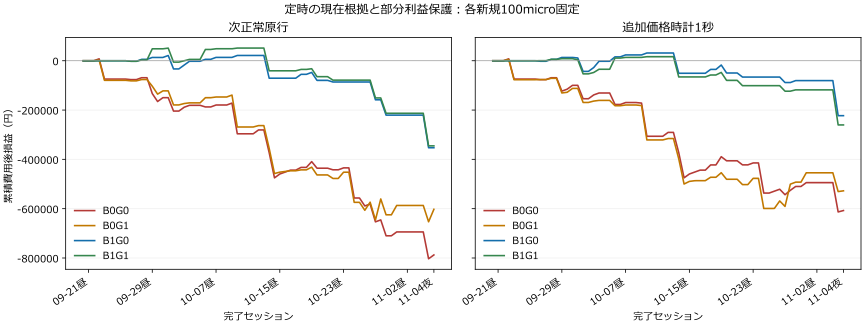

# 81の図と次の問い

[正式レポート](README.md)／[全設定・版5表](設定と結果.md)／[Viewer528資源](成果物/一覧.resources.json)。66場は全て既使用で、全案費用後赤字だった。

図は場末の費用後確定損益の累積で、場内の最大DDを示す図ではない。主と追加1秒を分け、全4案を表示する。

- [保存取引の局面診断](保存取引の局面診断.md)：結果後の分類。窓別換算bp幅を速度と誤記した初版を訂正し、金融再生・群の数値は変更していない。
- [共通知見](../../docs/議論/現在の新規根拠と部分利益保護を分けた比較.md)：同入口の利益保護と正益前損失、未知の板入力を分ける。
- [次の入口候補](../../docs/議論/チャートの現在性と補助情報の使い分け.md)：現在の勢い・価格回復・取得位置と、既知の補助情報を使い分ける未実装・未再生案。
- [追加の一次資料](../../docs/議論/外部再調査/失速と再開を分ける一次資料.md)：一般説明・心理仮説・検証範囲を区別する。
