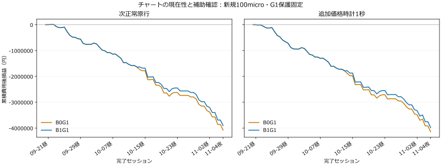

# 82の図と事後診断

[正式レポート](README.md)／[全設定・版5表](設定と結果.md)／[Viewer264資源](成果物/一覧.resources.json)。全66場は既使用で、2入口×2遅延は全て費用後赤字だった。

図は場末の費用後損益の累積で、場内の最大DDとは別である。主と追加価格時計1秒を分ける。

- [入口判断監査](入口判断監査.json)：全2,442枠×2政策の共有snapshot・包含・独立許可式等306,512照合差0。元指標系列や初動構造の全再生成は範囲外。
- [損益構造の診断](損益構造の診断.md)：正益前損失と平均回収額を分離。算術上の均衡率を将来予測にしない。
- [入口補助の事後診断](入口補助の事後診断.md)：短秒・OFIの未知／反対／中立／支持、順行／初動、失速を全群保存。群選択後の運用成績ではない。
- [三補助支持群の診断](三補助支持群の診断.md)：17玉は主14勝3敗でも赤字、価格時計1秒では小幅黒字。事後選択・小標本を独立した安定成績にしない。
- [最大損失例の診断](最大損失例の診断.md)：主は費用後正益に届かず−82,200円。追加価格時計1秒は実際には14秒後の適格板へ移り、取得価格と保護起動が変わった。利益放置と要求後悪化を区別する。
- [共通知見と次の問い](../../docs/議論/チャート主軸と失速時確認を比較した知見.md)：見送った3玉の改善、残る正益前損失、当時既知の構造否定と回収配分。
- [追加の一次資料](../../docs/議論/外部再調査/追尾の発動と返済約定を分ける.md)：部分返済・建値追尾、発動・要求・約定・確定益の区別。
