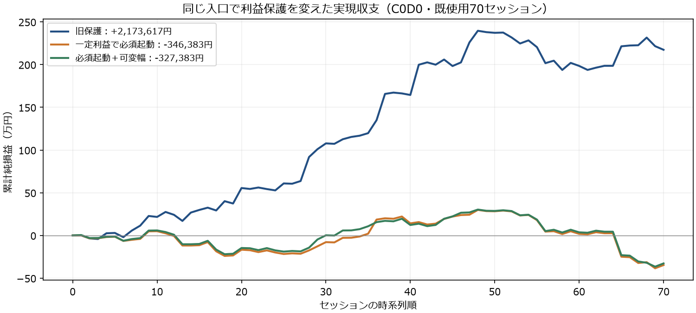

# 00109：三時間軸の取得確認と一定利益の必須保護

全70・1,680会計の金融、独立保存、純頻度、CSV再読、コード保存とViewer代表48資源のAPI照合を完了した。これは既使用期間の検証であり、新候補の採用なし、研究目標は未達。試行の検証終了と目標未達は別の完了記録に残す。

[設定と結果](設定と結果.md) / [集計CSV](../../outputs/01a1889f-f2af-7943-a047-543275ee9ed2/109損益CSV/候補別集計.csv) / [全セッションCSV](../../outputs/01a1889f-f2af-7943-a047-543275ee9ed2/109損益CSV/全セッション.csv) / [Viewer一覧](成果物/一覧.resources.json)

## 仮説・入力・固定

30分の背景、15分の押戻し、5分の取得確認と、一定利益での必須保護を比較した。元Sourceは106の既使用70場（2026-09-21〜11-06、夜間は開始日で表記）。miniは可変数量・各側最大10枚、100円/pt、片道税込38.5円。開始/米国開始20分静観、strict次5分と静観明け一回繰越、主分母は開始+20分〜予定末尾10分前の7,980枠、副は末尾30分前まで7,700枠。未知や待機を分母から落とさない。

C0はラージBBO代理と手数料、C5はさらに片道5pt追加滑り、D1は価格時計1秒の仮定。CSVの足終+60秒をRecord.Atで公表するモデルで、実通信遅延ではない。入口E0/E1×保護G0/G1/G2×4費用の24設定。売買は同じ符号反転条件。固定済み108 Q0とE0/G0のBook/Width/Clock280比較は全同体。

[技法固定](技法条件固定.json)、[金融条件](金融条件.json)、[市場前原本](市場前仕様/README.md)、[実行順序だけの変更](実行順序の変更.json)を保持。条件を先に固定し、成功first2の後、全70純頻度と金融を独立に並行した。新候補の閾値は途中変更していない。

## 主費用C0D0の結果

各行は独立した候補であり合算しない。費用後プラスの割合の分母は成立した新規件数。

| 候補 | 条件 | 費用後純額・円 | 新規件数 | 費用後プラスの割合 | 保存点時価DD・円 | 主参加率 | 一度費用後正益→赤字 |
| --- | --- | --- | --- | --- | --- | --- | --- |
| entry_E0_G0 | 元の入口＋旧保護（固定対照） | +2,173,617 | 466 | 43.56% | 860,249 | 27.81% | 188 |
| entry_E0_G1 | 元の入口＋一定利益の必須保護 | -346,383 | 466 | 71.67% | 988,184 | 12.03% | 57 |
| entry_E0_G2 | 元の入口＋必須保護・可変幅 | -327,383 | 466 | 71.67% | 981,797 | 9.75% | 57 |
| entry_E1_G0 | 三時間軸の入口＋旧保護 | -61,616 | 3 | 0.00% | 69,462 | 0.15% | 2 |
| entry_E1_G1 | 三時間軸の入口＋必須保護 | -49,616 | 3 | 33.33% | 57,462 | 0.14% | 1 |
| entry_E1_G2 | 三時間軸の入口＋必須保護・可変幅 | -49,616 | 3 | 33.33% | 57,462 | 0.14% | 1 |

## 分かったこと

G2の一定利益後の必須保護・可変幅は、一度費用後利益があった後の赤字を188件から57件へ減らし、保護起動後の赤字も30件から0件へ減らした。一方、実利益総額は6,283,041円から2,191,254円へ、実損失総額は−4,109,424円から−2,518,637円へ変わり、純額は2,501,000円悪化した。勝率は入口の精度だけを表さず、出口を変えても動く。

全24比較で実入口・枚数・気配・Sourceが一致することを確認した。C0D0のG0→G1では、負から勝へ変わった131件が＋1,863,000円改善した。一方、両方で勝った203件の実現益は−4,383,000円変わり、総額は−2,520,000円となった。G2も負→勝の改善＋1,867,000円に対し、両勝群の実現差が−4,368,000円だった。G1/G2の起動328件は初床がすべて10ptで、初回自己保護要求が最低床だったのは267/277件、259/290件。要求までの中央値は21秒、25秒だった。これは保存点に基づく説明で、新しい起動水準の検証結果ではない。

入口E1の複合条件は全7,980枠のうち46枠で成立（T36/R16、同時成立6を重複計上しない）。Source予定558候補と重なったのは3件で、実新規も3件。これは30分線だけの効果を分離した比較ではない。全買売候補15,960件のうち既知12,928・未知3,032、技術成立頻度と新規＋保有の参加率は別である。

11/06はC0D0の旧保護がデイ−100,388円・ナイト−42,232円、G2がデイ−45,388円・ナイト＋37,768円。改善しても日夜合計は−7,620円で、全期間も赤字だった。E1の11/06は0取引であり、入口改善の証明にはしない。

C0D0でG1/G2は466件・979枚、参加はそれぞれ12.03%/9.75%。E1は0.14〜0.15%。全体25%を満たしたのは旧保護E0/G0の4費用だけで、50%は全24未達。夜間単独25%も全24未達。

## 次の問いと限界

次は三時間軸を背景として維持し、確認イベントが一度起きたことと現在も有効な前提を区別する。Sourceの一出生一回取得と、足終+60秒の確認時計の組合せも別に比較する。利益保護は必須のまま、起動時に費用床まで残せる戻り幅が通常の値幅より小さくなりすぎない水準を技術的な値幅と結ぶ。現在の閾値を結果へ合わせて書き換えず、別試行で検証する。

未参加・退出後の仮想利益やMFE回収率は評価しない。手法間の実現額比較は残す。新候補は採用せず、11/09 Dayの価格・損益は未読で保持する。

24設定は同じ市場を使った探索で、独立な24回の実証ではない。mini実板・実約定は未検証。独立保存は全約定・所有・費用・保存点MTM/DD・入口と保護の保存根拠までで、全指標や全tickの別engine再現とは呼ばない。

[保存正本](成果物/結果.json) / [保存検算](成果物/保存会計の確認.json) / [金融全70](検査/金融全70場.json) / [純頻度の独立集計](検査/頻度の独立集計.json) / [同入口の出口診断](診断/同入口の出口比較/README.md) / [Native参照](成果物_金融/Native参照台帳.json)

[再現手順とコード保存](再現.md) / [代表Viewerの検査範囲](検査/Viewer8093代表48資源.json) / [コード保存の確認](再現資料/保存の確認.json)。市場前生成表と現在の結果表を区別する。
