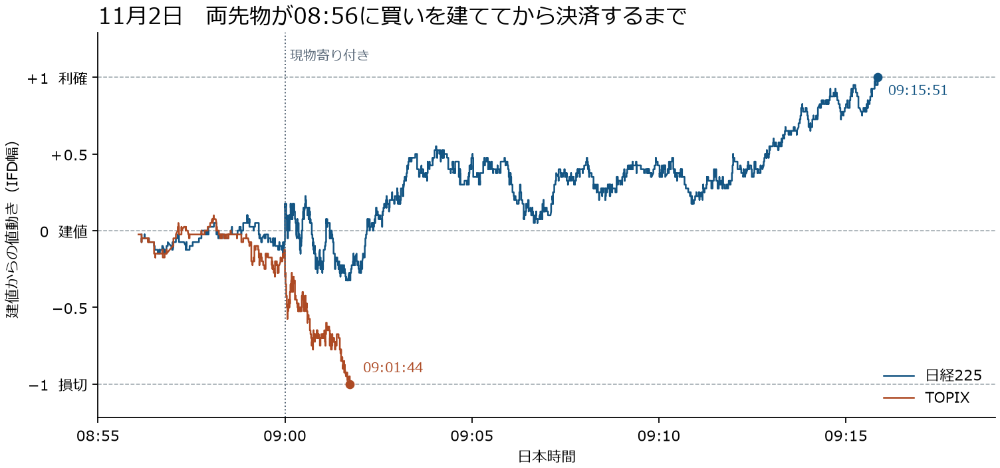

# 214　日経の199_02をTOPIXへ移すと成績が分かれた理由

2026年11月19日。日経199_02と、TOPIXの価格・量から同じルールで判断した213の03を固定した。2026年9月21日～11月17日の同じ42デイで、日経162取引の費用後収支は＋1,057,526円、TOPIX135取引は−129,786円。最も大きな違いは**同じ技術条件が、両指数で異なる時刻・方向を選んでいたこと**だった。さらに、両方がほぼ同時に同じ方向へ入っても、現物の寄り後に価格が分かれて損切りと利確が入れ替わる日があった。[元口座の日別CSV](../../outputs/00213_日経199のTOPIXデイ移植比較/README.md)

## 1　同じ条件が違う場面で成立した

両指数に対応する確定1分足があった14,284判断を揃えた。同じ足で主入口が同方向に成立したのは69回、逆方向は19回、日経だけ507回、TOPIXだけ448回。保有・予約で後に棄却されるシグナルも含む。現物営業日の09:00前に実際に建てた日は、日経10日、TOPIX14日、その両方に該当するのは4日。残りは片方だけが建てた。[成立しなかった条件の照合](入口の診断/README.md)

199_02には、その場の15分MACDヒストグラムの増分がまだ公表されていないとき、5分の方向・勢い、短期の価格回復などから入る条件（LC）がある。5分の指数移動平均（EMA8）から注文方向に、直近の平均的な値幅（ATR）の1.5倍を超えて離れた局面は見送る。TOPIXの09:00前LCは14取引。そのうち6件で日経は同じ1分足で既にこの上限を超えていた。TOPIXでは入口が成立し、この6件は1勝5敗、−83,501.6円だった。**日経ではその方向への値動きが既に大きくても、TOPIX自身の価格とATRで測ると追いかけの上限に届かず、注文が出る**のが観測された違いの一つである。

同じ終了分の照合には、元注文時刻から見て後で到着する相手の判断も含み得る。日経の判断をTOPIX判断より厳密に前の90秒以内に限ると、上限超過は4件・1勝3敗・−42,334.4円。範囲内6件は3勝3敗・−3,501.6円、位置を計算できない4件も全敗・−71,334.4円だった。これは既に取得した建玉を事後に分けた数値で、これを見送り条件にした口座収支は未検証。短期指標の追加だけでも説明しきれず、TOPIXの朝LCでMACD・RSI両方の勢いが同方向だった2件もともに赤字だった。

## 2　現物が開くと、選んでいた方向の違いが現れた

東証現物が営業した37日について、08:45以上09:00未満に建てた全取引を照合した。前節のLC集計は現物休場日の先物取引も含む。この表は5日の現物休場日を外し、通常入口とLCを含めているため、件数が同じでも内訳が異なる。表中の「09:15まで順行」は、09:00直前から09:15直前の正常板の仲値の変化が、元の注文と同じ方向だった件数。

|判断元と売買|朝の取得|09:15まで自指数が順行|実際の利益取引|IFD費用後収支|
|---|---:|---:|---:|---:|
|日経・買い|3|3|3|＋103,769円|
|日経・売り|7|5|7|＋273,461円|
|TOPIX・買い|7|0|0|−130,585.2円|
|TOPIX・売り|7|4|4|＋15,914.8円|

TOPIXの買い7件は全件で、09:00直前から09:15直前に買い方向へ進まず、最終的にも赤字だった。一方、取引の有無を問わず全37営業日で先物開始から09:00直前までの方向が09:15まで続いた日は、日経16日、TOPIX24日。この期間のTOPIXには寄り前の方向が続く朝も多くあり、その中で199_02が選んだ買いのタイミングと方向に問題が集中した。前ナイトの05:55直前まで遡り、両指数がそこから注文方向に進んでいたTOPIXの朝8件に絞っても2勝6敗。夜からの方向一致だけで識別できる結果は得られなかった。[全該当日の記録](朝の該当日.json)

両方が朝に入った通常日は4日。同方向3日、逆方向1日だった。10月20日は両方が08:56に売り、両方が利確。11月2日は両方が同じ終了分で買い、TOPIXは3,950.0から3,930.0に下がり09:01:44に損切り、日経は62,690円から63,090円に上がり09:15:51に利確した。下図は各々が実際に保有していた間だけ、買建値に対する返済側の最良買気配を描いたもの。

現物の日報でも、11月2日の前場始値→前場終値は日経連動ETF＋0.77%、TOPIX連動ETF−0.12%、アドバンテスト＋5.19%、東京エレクトロン＋3.48%。現物が開いた後に指数間で強弱が出たことと整合する。9月30日時点のこの2銘柄の合計ウェートは日経21.29%、TOPIX3.97%。株価平均型と浮動株時価総額加重型では、同じ銘柄の動きへの感応度が異なる。ただし前場の日報は09:01:44までの銘柄別寄与を表しておらず、寄り前の現物注文も未観測。半導体2銘柄が先物の損切りを引き起こしたとは特定できない。[現物の日報20日・構成ウェートと一次研究](指数と寄り付き.md)

## 3　変動幅、流動性、費用はどこまで説明するか

両先物で同時に観測できた5分仲値変化は、旧42デイの予定3,402窓中3,073窓。5分騰落率の同時相関は0.738。通常日の寄り前は111窓で0.472、09:00～09:30は222窓で0.548だった。通常日の08:45～09:00の1窓あたりの変動の大きさ（二乗平均平方根）は日経21.3、TOPIX22.4 miniティック。両方とも値幅が出ていても向きは一致しにくい。全体で日経を1窓先、TOPIXを次の窓にすると相関は−0.011、逆順はほぼ0。今回の日経判断の成績から、日経価格がいつもTOPIXに5分先行すると推定するのは難しい。

TOPIXのIFD幅を固定呼値比0.05から直前5デイの変動比（旧期間で利用可能な37日の中央値0.04676）へ置き換えた。両幅・両商品とも決済を観測できた同じ通知に限ると、日経が選んだ151件をTOPIXで測った費用後平均は＋0.097幅→＋0.109幅、TOPIXが選んだ124件は−0.056幅→−0.069幅。日経の値動きに対して割高な利確幅を設定していたことだけでは、この符号差は解消しなかった。分母からは各判断元とも最初の5日で9通知、残りで観測不足2通知を除いた。この比較は元口座の取得を固定した価格経路測定で、異なる幅の新しい口座成績を表さない。[値幅と時計の計算結果](値動きの集計.json)

|固定口座の取得・決済時刻を使った分解|日経199_02|TOPIX移植03|
|---|---:|---:|
|仲値同士で測った売買方向の値動き|＋1,426,000円|＋29,500円|
|往復の売買気配差による負担|194,000円|80,500円|
|手数料＋想定追加滑り|174,474円|78,786円|
|実側・費用後収支|＋1,057,526円|−129,786円|
|1取引の設定幅に対する平均総負担|0.0826幅|0.0808幅|

旧42日の自指数判断でTOPIXが稼いだ仲値変化は平均＋0.0334幅。日経の＋0.3119幅より小さく、自身の取引負担0.0808幅を賄えなかった。特に09:00前はTOPIXの仲値段階で−114,750円、09:00以後の取得は＋144,250円であり、後者の費用後は＋5,468円。約定原行のラージ最良気配枚数の中央値は日経8枚、TOPIX9枚、取得時スプレッド中央値は両方2 miniティック。TOPIXだけ板が特に薄かったという説明は、この観測では支持されない。朝は同じ場の20分出来高平均をまだ作れず、相対出来高による説明は保留した。[板と費用の原行照合](板と費用/README.md)

## 4　判断元と取引商品の寄与、残る不確実性

213で保存した同時刻・同方向・同じ呼値数の観測では、判断元と商品を両方日経にした平均は＋0.224幅、両方TOPIXは−0.049幅。両方の組合せを一つずつ交換する順序を平均すると、差0.274幅のうち0.190幅が**どちらの指数の取引時刻・方向・元幅・期限を採ったか**、0.084幅が**同じ判断でどちらの商品を測ったか**に対応する。前24日と後18日で判断元による差は＋0.193、＋0.184幅。1日ずつ除いても＋0.163～＋0.215幅だった。5日連続ブロックを再抽出した範囲（中央95%）は＋0.107～＋0.272幅。商品側の範囲は＋0.002～＋0.161幅で不確実性が大きい。これは同じ既使用期間の平均の分解。ユーザーの口座損益の何割を特定原因が生んだかを推定したものではない。

以上から、**朝に自指数の短期条件が成立したとき、相手の指数でもまだ押し戻しからの回復段階なのか、相手は既に伸びきっているのか**が、今後の追加日に当時情報で判別する価値のある違いである。相手の指標が未公表の局面も別に残す。次の独立した期間で両指数の入口を固定し、この状態と寄り後の推移を記録することで、日経で候補を選んだ影響と市場構造に由来する再現性を分けられる。11月18日は既に213で評価済み。この追加日の6件の日経由来診断はTOPIX呼値幅でも平均−0.309幅で、日経由来なら常に有利という見方を裏付けない。

## 入力・再現

- [診断条件](診断条件.md)・[使用手法と閾値の版8](設定と結果.md)。日経miniとminiTOPIX各1枚、ラージ板代用、同一枠、元IFD、終了15分前まで。既存の決済後の仮想利益は口座収支に加えない。
- まず[213の価格索引・固定台帳の復元](../00213_日経デイ199の入口をTOPIXへ固定移植する/README.md)と[日経追加日の復元](../00213_日経デイ199の入口をTOPIXへ固定移植する/日経の追加デイ/README.md)を行う。正常板の時刻と原行順は213をそのまま用いた。
- リポジトリ直下で、このフォルダの `値動きを照合する.py` と `朝の取引を対応させる.py` を順に実行する。使用環境はPython 3.14.3とNumPy 2.5.4。後者の描画にはMatplotlibと日本語フォントを使う。5分端点の鮮度は30秒、区間内の正常気配空白の上限は300秒。過去5日換算と呼値換算の比較では、旧設定の決済原行・価格・損益を213の保存済み対照へ照合する。
- 入口の分解、板の費用、現物の日報の再現手順は各節の資料に記載。先物価格は価格時計ベースで、売買主体・サーバー受信順は判別できない。
- [独立検算](独立検算/別計算.py)を同じ入力で実行し、相関・朝の買い損益・判断元と商品の差・直前5デイ換算後の実側決済まで照合した。別系列の公表5分足でも相関は全体0.742、通常日の寄り前0.489だった。[照合票](独立検算/照合票.json)
