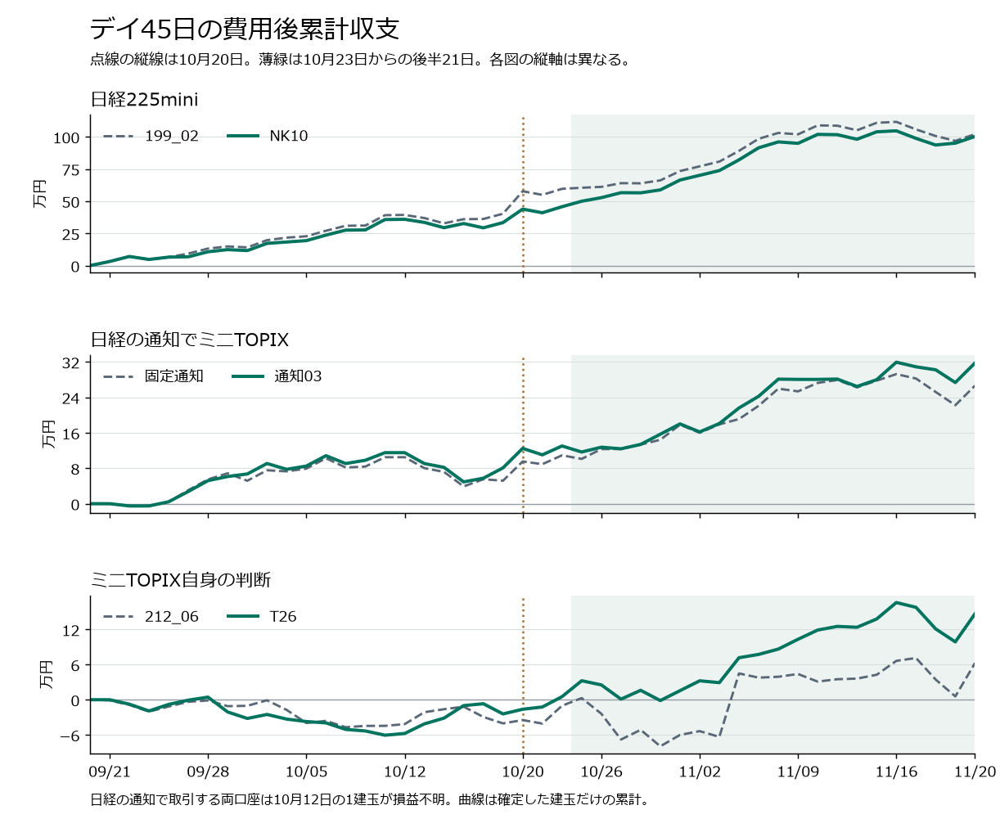

# デイ45日で、特定日の利益を外しても残る入口を探す

2026-11-22。対象は2026年9月21日〜11月20日の全45デイ。日経は199_02を基準に残し、NK10を次の比較候補とする。TOPIXでは日経の通知を使う03が有望。TOPIX自身の判断にも、上位3日を外して黒字になるT26が見つかったが、前半の利益は小さく、直近3日も赤字だった。[手法別の日次CSV](../../outputs/00217_デイ入口の利益集中と安定性/README.md) ・ [全候補の比較表](全候補の比較.md)



10月20日・11月19日の日経と、11月16日の日経通知で取引したTOPIXは、旧入口と新入口の建てた位置をチャートでも比較できる。[SessionTradeViewerで3場面を開く](Viewer/README.md)

## 特定日を外した成績

全額がmini1枚の費用後、単位は円。上位3日は手法ごとに確定した日次収支が大きい3日。通知の2口座には同じ10月12日の不明決済が1件ずつあり、表には判明した取引の寄与を集計した。各口座の数値を独立に読む。

|銘柄・入口|建玉／参加日|黒字建玉／確定建玉|既知利益|既知損失|既知収支|10/20除外収支|利益上位3日除外収支|日末最大DD|
|---|---:|---:|---:|---:|---:|---:|---:|---:|
|日経199_02|181／45|110／181|2,362,530|1,342,467|+1,020,063|+845,448|+668,526|147,463|
|日経 NK10|177／45|108／177|2,318,684|1,316,313|+1,002,371|+897,756|+720,834|109,924|
|日経通知でTOPIX・基準|140／43|79／139|831,895.6|565,516.0|+266,379.6|+222,964.0|+140,132.8|70,170.4|
|日経通知でTOPIX・通知03|99／42|58／98|700,401.2|382,844.0|+317,557.2|+273,558.0|+189,893.2|65,918.0|
|TOPIX専用212_06|225／45|118／225|951,635.2|888,945.2|+62,690.0|+57,025.2|−133,054.4|82,339.2|
|TOPIX専用 T26|161／44|92／161|719,058.8|572,268.4|+146,790.4|+138,791.2|+28,128.0|67,170.4|
|日経の条件をTOPIX上で計算する移植03|148／45|73／148|656,397.2|770,770.0|−114,372.8|−146,122.0|−208,869.6|177,033.6|

日経199_02の10月20日は＋174,615円で、全収支の17.1%。日経通知でTOPIXの上位3日は11月20日・10月20日・11月6日、TOPIX専用212_06の上位3日は11月4日・11月20日・10月22日だった。専用212_06は10月20日に5,664.8円しか得ておらず、問題になっていた集中日は別だった。

|入口|前24日収支|後21日収支|うち直近3日|確定赤字日|保有時間率|日次／建玉の中央値下限|
|---|---:|---:|---:|---:|---:|---:|
|日経199_02|+595,917|+424,146|−37,463|12|51.9%|22,692／12,923|
|日経 NK10|+457,071|+545,300|+14,614|12|50.9%|27,692／12,923|
|日経通知でTOPIX・基準|+109,150.4|+157,229.2|−16,086.8|16|52.7%|6,582／2,416.4|
|日経通知でTOPIX・通知03|+130,238.8|+187,318.4|+8,664.0|15|38.5%|7,416.4／3,416.4|
|TOPIX専用212_06|−10,279.6|+72,969.6|−8,587.6|18|54.7%|2,248.4／416.4|
|TOPIX専用 T26|+5,230.0|+141,560.4|−11,004.0|19|40.8%|3,832.8／916.4|

## どんな時に見送ると結果が変わったか

**日経 NK10** は元のテクニカル入口が成立しても、①1分の出来高が直前3本平均の1.5倍以上、②売買予定と逆向きの実体がその足の値幅の25%超、③5分の方向指数（DI）の差も予定方向を支持しない、の3点がそろえば見送る。買いなら売り圧力が価格と量の両方に表れた状況で、売りは左右対称。日経の市場心理として「大口が売った」とまでは観測できず、板と足で確認できるのは価格と量の変化までである。

10月20日には旧入口の11:56の売り＋33,923円を見送り、後から買いで−36,077円になった。11月19日にも同じ時刻の黒字売りを見送ったが、その後の保有枠の使い方が変わり、こちらは日計で52,077円改善した。出来高閾値を1.25・1.50・1.75倍に変えても上位3日除外収支と日末DDの改善は残った。赤字日は12日で変わらず、9週のうち旧より良かったのは2週、悪化4週、同額3週。利益集中と累計下落を抑える候補として旧と並べる。[日経の候補・取引経路](日経/README.md)

**日経通知03** は日経が実際に建てた通知を起点とし、TOPIXの直近12分が逆方向で、両端の値動きが途中の1分変化の絶対値合計の35%以上なら見送る。例えば日経が買いを通知しても、TOPIX自身が往復の少ない下落を続けていれば待つ。損失は182,672円減った。一方、見送られた旧45件の合計は−4,762円で、新たに建った4件が＋46,415.6円。収支改善の約91%が後の4件に依存した。通知元の199_02は固定し、NK10の通知でTOPIXを取引する組み合わせは未検証。未参加3日のうち、2日は元口座でも有効な板・取得機会が不足し、残りの11月10日は4通知すべてが見送り条件に該当した。[取得の入れ替わり・近傍4案](日経通知/README.md)

**TOPIX専用 T26** は212_06の押し戻し条件を維持し、09:00〜09:29は元の条件を通す。それ以外は確定した連続12本の1分終値から、売買方向への純変化を途中の絶対変化の合計で割り、0.25以上のときだけ建てる。9時前も同じ判定を行う。参加できなかった9月21日は3つの買い要求のうち、1件は値動きが逆方向、2件は連続足不足。旧と共通の92件以外では、旧のみの133件が−2,618.8円、新たに枠を得た69件が＋81,481.6円。日計で改善25日、悪化17日、同額3日で、改善幅の大きい3日を外しても旧との差は＋14,931.6円残った。

ただしT26の利益の96.4%は後21日に発生し、赤字日は18日から19日に増えた。9時台の例外を10:00まで広げたT17では、上位3日除外は−1,622.8円。開場後の需給が時間帯差を生んだ可能性はあるが、現物の注文の内訳は観測していない。時間境界が次の市場でも効くかは追加日で確認する。[TOPIX専用の段階別検証](TOPIX専用/README.md)

## 利益を伸ばすことと、損失を減らすこと

|変更|既知の建玉が減った分の往復費用節約|費用控除前収支の差|赤字建玉1件当たり平均損失（旧→新）|
|---|---:|---:|---:|
|日経 NK10|4,308円|−22,000円|18,908→19,077円|
|日経通知03|23,927.6円|+27,250円|9,425→9,571円|
|TOPIX専用 T26|37,350.4円|+46,750円|8,308→8,294円|

TOPIXの2案は既知建玉がそれぞれ41件・64件減り、赤字建玉の件数も減った。1回負けたときの平均損失はほぼ横ばいで、損切りが浅くなったわけではない。日経で赤字建玉の深さを優先すると別案NK14に利点があり、平均16,331円、総損失963,543円まで低下した。一方、上位3日を外した収支は＋593,374円まで減り、11月4日の利益が大きくなった。

固定手法で同日に費用後赤字が2回続いた時点から当日の新規をすべて止める比較も行った。日経は全45日参加のまま日末最大DDが147,463円から78,616円へ下がる一方、収支＋929,142円、赤字13日となる。移植03では当日停止の3案すべてで日次中央値が赤字のままだった。[全候補と当日停止の比較](全候補の比較.md)

## 選択・再現条件

- 固定対照4、変更条件72の計76口座設定を比較。内訳は日経20、日経通知14、TOPIX専用29、TOPIX移植の固定対照1、固定4手法ごとの当日新規停止3条件（12）。条件が異なっても同じ取引になった例がある。前24日だけの当初選択は日経NK03、通知04、専用T03。NK03は後21日で旧と同じ、通知04は後21日で旧より悪化、T03は後21日に−31,529.6円。専用の二巡目選択はT21、三巡目は適格なし。今回の3候補は全期間を調べた後の比較候補で、45日すべて既使用。[検証方針](検証方針.md) ・ [手法×時間スケール・閾値](設定と結果.md)
- 建玉は各口座mini1枚、予約・保有中の追加禁止。開始一律待機なし、15:30までに終了。ラージの最良気配でmini約定を代用。各入口で建てた時点の同幅利確・損切りと期限を固定した単純IFD。片道の手数料／想定追加滑りは日経38.5円／5pt、TOPIX41.8円／0.25pt。保有率は確認できた保有秒数を08:45〜15:30の全45日分で割る。日末最大DDは日末既知累計の最高値からの最大下落額で、場中の下落は含まない。
- 共用入力は `../JP_OSE_Data/future/{NK225,TOPIX}` と `inputs/` の固定入力。Pythonの環境は日経・[日経通知](日経通知/README.md)・[TOPIX専用](TOPIX専用/README.md)の個別手順を参照。基準口座は試行216の元帳と照合。各経路のスクリプトを先に実行して比較元帳を再生成する。下記は集計・閲覧資料を再作成する例。CSV生成器の出力・照合先は新規ディレクトリを指定する。

```powershell
$trial = (Get-ChildItem study -Directory -Filter '00217_*').FullName
python -X utf8 (Join-Path $trial '集中と安定性を集計する.py') --閲覧設定 (Join-Path $trial '閲覧候補.json')
$deps = Join-Path $env:USERPROFILE '.cache/codex-runtimes/codex-primary-runtime/dependencies/node'
& (Join-Path $deps 'bin/node.exe') scripts/損益CSV/候補別に出力する.mjs --input 'work/217比較/閲覧用入力.json' --output 'work/217照合用CSV' --proof 'work/217照合画像' --dependencies $deps
python -X utf8 (Join-Path $trial '累計を描く.py')
```

累計図は試行216と217の公開CSVを読む。週別成績・未知を含む上下限は各候補の集計CSVで確認できる。
