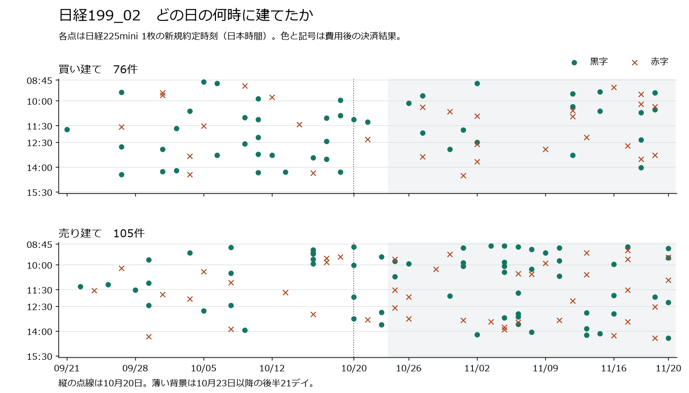

# 日経199_02は、いつ買い建て・売り建てして利益を得たか

2026-11-22。対象は2026年9月21日〜11月20日の全45デイ。日経199_02が取得した181件を、判断・新規・決済の原板行と日本時間で照合した。費用後収支＋1,020,063円のうち、**売り105件が＋749,915円（73.5%）、買い76件が＋270,148円**。売りの収支は前半・後半とも黒字だった。取引ごとの判断時刻・建値・決済時刻・値幅・損益は[181件の建玉明細](../../outputs/00218_日経199の売買方向と日時/218_日経199_02/建玉明細.csv)、日付だけを選んで比較する場合は[45日の日別CSV](../../outputs/00218_日経199の売買方向と日時/218_日経199_02/日別.csv)を参照。



## 損益が生じた経路

|元の両側口座の内訳|買い建て|売り建て|
|---|---:|---:|
|建てた日／対象日|30／45|37／45|
|件数・黒字／赤字|76件・47／29|105件・63／42|
|費用後の建玉勝率|61.8%|60.0%|
|利益／損失|857,381円／587,233円|1,505,149円／755,234円|
|収支|+270,148円|+749,915円|
|利確先着／損切先着／未到達|16／15／45|49／15／41|
|到達済みで利確側が先着した率|51.6%|76.6%|
|先着決済の収支／未到達決済の収支|−82,387円／+352,535円|+913,072円／−163,157円|
|建玉収支の中央値／日次収支の中央値|+9,423円／0円|+13,923円／+615円|
|黒字建玉の平均利益／赤字建玉の平均損失|18,242円／20,249円|23,891円／17,982円|

売りは利確に届いた49件で＋1,314,227円。買いは未到達45件のうち31件が費用後黒字になった。判定幅は元の要求ごとの150・200・350・400ptで、売買で件数構成が異なる。同じ±350pt・60分に限っても、買いは55件（5順・10逆・40未到達）で＋96,765円、売りは59件（17順・6逆・36未到達）で＋212,457円だった。

## 時間帯と日付

各建玉を実際に取得した時刻で一度だけ分類し、決済までの全収支を帰属させた。境界は開始を含み、終了を含まない。固定時計なので、先物のみで売買された日にも同じ区切りを使う。[時間帯別CSV](../../outputs/00218_日経199の売買方向と日時/218_日経199_02/時間帯別.csv)

|新規時間帯（日本時間）|買い　件数／黒字件数|買い収支|売り　件数／黒字件数|売り収支|
|---|---:|---:|---:|---:|
|08:45〜09:00|3／3|+103,769円|8／8|+312,384円|
|09:00〜11:30|33／19|+2,459円|47／29|+380,381円|
|11:30〜12:30|11／7|+108,153円|17／9|+28,691円|
|12:30〜15:30|29／18|+55,767円|33／17|+28,459円|

11:30より前に建てた売りは計55件・＋692,765円で、売り収支の92.4%。09:00より前の売り全勝は8日8件に限る。09:00〜11:30だけでも26日47件があり、前24日は＋154,537円、後21日は＋225,844円、同群の利益上位3日を除いても＋160,151円だった。

|期間・除外条件|買い収支|売り収支|
|---|---:|---:|
|前24日（9月21日〜10月22日）|+346,843円|+249,074円|
|後21日（10月23日〜11月20日）|−76,695円|+500,841円|
|11月分（11月2〜20日）|−125,002円|+410,996円|
|10月20日を除く|+236,225円|+609,223円|
|各方向にとっての利益上位3日を除く|+71,918円|+432,301円|

買いの上位3日は10月9日・19日・1日、売りは10月20日・11月5日・4日。両方向が同日に建ったのは22日、買いだけの日が8日、売りだけの日が15日。日次中央値にはその側の取引がなかった日も0円で含める。

### 10月20日の5建玉

|方向|新規日時（2026-10-20 JST）|建値|決済日時（同日 JST）|決済値|費用後収支|
|---|---|---:|---|---:|---:|
|売り|08:56:04|64,790|09:20:43|64,390|+38,923円|
|売り|10:02:01|64,440|10:13:23|64,090|+33,923円|
|買い|11:08:01|64,420|11:55:47|64,770|+33,923円|
|売り|11:56:04|64,770|12:53:56|64,420|+33,923円|
|売り|13:16:04|64,430|14:08:28|64,080|+33,923円|

この日の＋174,615円は、下落を売った4件の＋140,692円と、途中の戻りを買った1件の＋33,923円。11月19日は買い4件が−19,308円、売り3件が−18,231円で、両方が赤字だった。この2日はViewerで元口座の約定位置も確認できる。[チャートで開く手順](../00217_デイの利益集中と入口条件を比較する/Viewer/README.md)

## 買いの後半失速を、当時分かっていた価格で調べる

各日の08:45以降で最初に観測できた正常な最良売買気配の中値を基準とし、判断が生まれた原行の中値と比較した。181件すべてで当時の原行・時計・中値を確認した。ここでいう「上」「下」は売買判断時点の位置である。

|朝の基準に対する判断時の位置|買い件数|買い収支（前24日／後21日）|売り件数|売り収支（前24日／後21日）|
|---|---:|---:|---:|---:|
|上|47|+282,921円／−79,540円|28|+19,076円／+152,768円|
|下|29|+63,922円／+2,845円|76|+229,998円／+364,150円|

同値は売り1件・−16,077円。買いの後半赤字が集中したのは「朝から上昇した位置での買い」で、同じ条件は前半の買いの最大の利益源でもあった。位置だけで固定的に買いを止めると双方を落とす。売りは朝の基準より低い位置での76件でも、10月22日までとその後の双方で利益を得た。

別途、08:45足の始値と15:29足の終値で事後に分けると、下落27日で売り＋771,994円・買い−147,002円、上昇18日で売り−22,079円・買い＋417,150円だった。終点は新規判断時には分からない。下落日が多かったことと、売りが値幅を取れた時間帯の両方が、この45日の結果に表れている。[当時の板中値の照合](当時の価格位置.py)

## 売買の片方だけを許すとどうなるか

同時保有・予約は1枚までなので、一方を止めると空いた枠に別の建玉が入る。元の入口・優先順・単純IFDを使って原行順に再生した。買い限定は108件で**−70,316円**。元口座と共通の買い65件は＋247,995円だったが、新たに成立した買い43件は−318,311円だった。売り限定は131件で**既知＋794,990円、決済不明1件**。全取引が確定した元の両側口座は181件で＋1,020,063円。売り収支の寄与が大きいという観察だけでは、売り限定への変更は支持されない。[片側口座の再現条件と差額](片側対照/README.md) ・ [口座別CSV](../../outputs/00218_日経199の売買方向と日時/README.md)

## 再現と適用範囲

- 元入口は[日経199_02](../00199_保留中の旧幹を確認済みの根拠で切り替える/README.md)。09:00前の一律待機なし、単純IFD、15:30までの決済、日経225mini 1枚（1pt＝100円）。最良気配は共用ラージ板、往復費用1,077円には片道手数料38.5円と片道5ptの想定滑りを含む。全181件とも決済が確定。判断・新規・決済は原板価格時計の日本標準時で、実注文の受信時刻ではない。[設定と結果](設定と結果.md)
- 元口座を再生し、試行216までの金融正本と全181件の方向、日時、価格、新規・決済原行、費用後損益等を照合。各建玉について「方向付き値差×100円−1,077円」を再計算し、日別に方向別の件数・利益・損失・収支の合計が元口座に一致することを検査した。この45日は既使用で、将来の曜日・時間帯や方向の成績についての独立検証は含まない。
- [片側対照の入力復元手順](片側対照/README.md)を済ませ、以下をリポジトリ直下で実行する。CSV出力器は既存ファイルを上書きしないので、再計算には新しい比較先を使う。図は公開先のCSVを使う。

```powershell
$trial = (Get-ChildItem study -Directory -Filter '00218_*').FullName
python -X utf8 (Join-Path $trial '片側対照/片側を再生する.py')
python -X utf8 (Join-Path $trial '当時の価格位置.py')
python -X utf8 (Join-Path $trial '売買と日時を集計する.py')
$deps = Join-Path $env:USERPROFILE '.cache/codex-runtimes/codex-primary-runtime/dependencies/node'
foreach ($account in '元の両側','買い限定','売り限定') {
    & (Join-Path $deps 'bin/node.exe') scripts/損益CSV/候補別に出力する.mjs --input "work/218集計/$account.json" --output 'work/218確認用CSV' --proof "work/218確認用画像/$account" --dependencies $deps
}
python -X utf8 (Join-Path $trial '建玉日時を描く.py')
```
