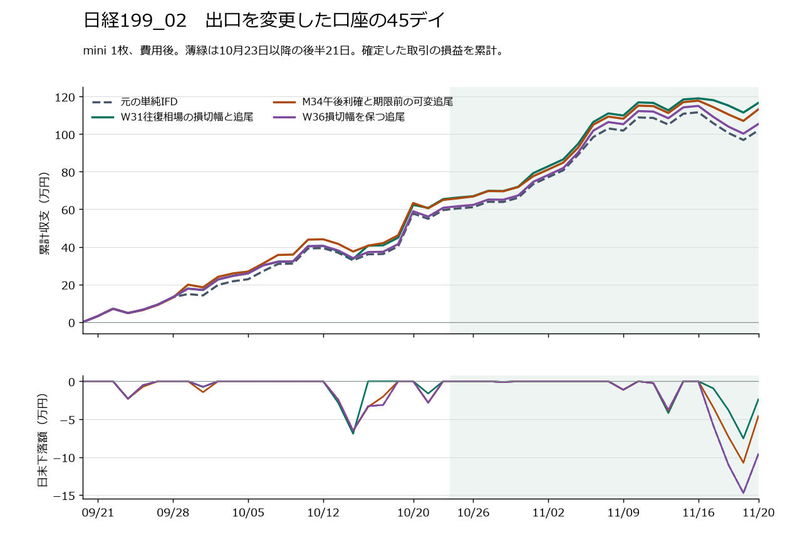

# 219　日経199_02の利益保護と出口条件を比較する

2026-11-22。**全体の損失と資金の落ち込みを重視するとW31、最初の損切幅を広げずに利益を守るならM34** が、次の追加デイで比較する候補になった。どちらも元の181建玉に固定した検証と、後続の取得まで計算した1枚口座の両方で、元の単純IFDより総損失が小さく、費用後収支が高かった。[45日の日別・建玉別CSV](../../outputs/00219_日経199デイの出口比較/README.md) ・ [全113案と元IFDの比較](全出口の比較.md) ・ [設定表](設定と結果.md)

## 口座の実現損益

対象は共用原板にある2026年9月21日〜11月20日の全45デイ。日経225ラージの最良気配で日経225mini 1枚の約定を代用した。利確・損切り・期限は各新規で同時に設定する。新規・返済の都度、手数料38.5円と追加滑り5ptを計上し、1往復当たり1,077円を控除した。損失と下落額は正の円額で表示する。日末最大下落額は日末ごとの累計収支がそれまでの最高額から下がった最大幅。

|出口|建玉|利益|損失|費用後収支|日末最大下落額|最大1件損失|保有時間率|
|---|---:|---:|---:|---:|---:|---:|---:|
|元の単純IFD|181|2,362,530|1,342,467|+1,020,063|147,463|41,077|51.87%|
|**W31　午後の往復相場と期限別追尾**|179|2,397,376|**1,231,159**|**+1,166,217**|**75,386**|45,077|51.61%|
|**M34　午後利確と期限前の可変追尾**|184|2,433,914|**1,302,082**|**+1,131,832**|**107,540**|41,077|51.11%|
|M28　M34の通常時の起動水準を統一|184|2,448,991|1,306,159|+1,142,832|107,540|41,077|51.55%|
|W36　損切幅1RでW31と同じ追尾|182|2,388,376|1,334,390|+1,053,986|147,463|41,077|51.47%|
|M04　午後利確のみ|183|2,410,299|1,321,390|+1,088,909|147,463|41,077|51.58%|

全6口座とも45日すべてで取得、決済不明0件、赤字日は12日。保有枠は予約を含めて買売合計1枚。保有率は08:45〜15:30の実時間を分母とする。W31の建玉中央値は13,923円、日次中央値は22,692円。M34はそれぞれ12,923円・27,615円、元は12,923円・22,692円だった。

## どこで何を変えるか

Rは199_02が新規時に決めるIFDの片幅で、建玉により150・200・350・400pt。買いの順行は新規Askから現在Bidまでの上昇、売りでは新規Bidから現在Askまでの下落として判定する。両方向に同じ条件を使う。

- **W31**　元利確1Rを維持する。11:30以降の取得で、直前の完成1分足12本分の純変化が値動きの総距離の35%以下なら、初期損切幅を1.10Rにする。行き来が多い場面では一時的な逆行で手放すと損になりやすい、という仮説である。他の建玉は1R。順行が通常期限なら0.90R、場末までの期限なら0.95Rに達したとき、最低20pt、最高順行から0.70R引いた位置の高い方で追尾する。72件で起動、実際に追尾で返済したのは4件。[閾値と近傍比較](逆行幅の結果.md)
- **M34**　損切幅は全建玉1R。12:30以降に新規取得する建玉は利確を0.90Rに縮め、他は1Rとする。通常期限は0.85R、場末期限は0.95Rの順行で追尾。どちらも返済要求まで残り10分以内なら、その時点の順行0.45Rでも起動する。最大順行から原則0.80Rの幅を取り、最後の10分に完成1分足の勢いが失速するか値動きが収縮したら0.35Rへ狭める。最低床は20pt。失速は短いEMAと方向効率、収縮は標準偏差と終値の位置で判定した。103件で起動し、14件を追尾で返済。基準の1秒遅延では起動後の赤字決済は0件だった。[期限別の閾値と成績](午後利確と期限前保護の結果.md)
- **M28**　M34の通常時の起動を期限によらず0.95Rに統一する。元181建玉固定での収支はこの表の中で最も高い。一方、この45日では「最後の10分だけ保護する」M27と新規・決済原行が全件一致した。M28を併記する根拠は期限前の保護と利確短縮の成績であり、早期の0.95R起動の効果はこの期間から識別できない。

いずれも起動後に床を下げない。追尾の床に触れた正常気配で成行返済を要求し、1秒以上後の最初の有効な返済側気配で約定を代用する。初期IFD・期限決済が先に成立した場合はそちらが優先。場末は15:29に返済を要求し15:30まで、正常気配不足は不明にする。[口座と板の再生仕様](口座再生の仕様.md)

## 期間差・方向差・利益集中

|出口|前24日収支|後21日収支|直近3日収支|10/20除外収支|自身の利益上位3日除外収支|買い収支|売り収支|
|---|---:|---:|---:|---:|---:|---:|---:|
|元IFD|+595,917|+424,146|−37,463|+845,448|+668,526|+270,148|+749,915|
|W31|+654,071|+512,146|−14,386|+991,602|+792,757|+359,302|+806,915|
|M34|+649,917|+481,915|−11,463|+960,217|+758,372|+262,071|+869,761|
|M28|+635,917|+506,915|−11,463|+971,217|+769,372|+270,148|+872,684|

前24日・後21日の総損失は、元462,925円・879,542円、W31は414,694円・816,465円、M34は432,694円・869,388円。W31の買いは11:30以降が元より94,308円改善し、それ以前は5,154円悪化した。M34の収支増は売りが119,846円を担い、買いは8,077円悪化した。M28の収支増は全額が売りだった。いずれも買い・売りで入口を変えていない。

W31の日次収支が元を上回ったのは7日、下回ったのは4日。M34は上回ったのが10日、下回ったのが13日だった。最も改善した3日を取り除いても、元に対する収支差はW31が＋30,077円、M34が＋7,923円。各暦週を一つずつ除いた9通りでも両者はすべて総損失減・収支増だった。週除外は同じ45日の感度である。W31の前24日の日末最大下落額は旧65,231円に対して69,231円で、あらかじめ定めた前半の選抜条件を満たさなかった。その群で選ばれたのはW36。M34は最終の期限前保護9案の中で前24日の規則により選ばれた。[週を外した感度](週を外した感度.md) ・ [各巡の前半選抜](前半の選抜.md)

## 早く返すと後続の損益も変わる

|出口|元181件固定の損失|元181件固定の収支|口座に共通で残った建玉の決済差|後続建玉の入れ替わりによる収支差|口座全体の収支差|
|---|---:|---:|---:|---:|---:|
|元IFD|1,342,467|+1,020,063|0|0|0|
|W31|1,265,313|+1,076,063|+60,000|+86,154|+146,154|
|M34|1,301,082|+1,074,063|+55,000|+56,769|+111,769|
|M28|1,306,159|+1,108,063|+89,000|+33,769|+122,769|

11月17日12:42:03の買いは、元IFDでは13:05に−36,077円で損切りされた。W31は一時的な逆行を許し、13:42の期限に−5,077円で返済した。後続の売りの違いも含めて、この日のW31は元より49,000円改善した。反対に10月7日は、11:05の売りをW31が利益保護して8,000円改善した後、早く空いた枠で次の売りに入り、当日全体では元より19,000円悪化した。[両日のViewerと全約定](Viewer/README.md)

元口座で一度は費用後黒字だった165件のうち、赤字で決済したのは55件、合計損失891,235円。W31では52件・845,004円、M34では51件・863,927円が残った。10月14日11:26の買いは最大＋16,923円から−41,077円に転じ、両方の主候補でも防げなかった。最初の小さな黒字から保護を始めたE03では377建玉、既知収支−504,952円、不明1件となった。損失を減らすと同時に、元々得られた大きな利益まで縮めてしまった。[元建玉の経路診断](経路診断/README.md)

## 検証した範囲と継続条件

最初の一律利確・損切・追尾14案の後、失速や残り時間を使うM群35案、入口時の経路効率と損切余裕を使うW群36案、午前の利幅延長L群15案、逆行からの回復K群7案、午後利確と損切余裕を組み合わせるC群6案を検証した。合計113案のうち、45日の口座で損益不明0件・元より総損失減・収支増を満たしたのは27案。そのうち25案は元181件固定でも両方の改善が残った。閾値が近い案や同じ決済になった案を含む。[初回条件](閾値.md) ・ [利幅延長](利幅延長/README.md) ・ [逆行からの回復](逆行後の戻り/仮説.md) ・ [午後利確と損切余裕](午後利確と損切余裕/仮説.md)

日中の時刻と保有期限の仮説は[218の売買・日時別調査](../00218_日経199デイの売買方向と建玉日時を検証する/README.md)から着想した。後続の閾値には10月6日に起きた期限の板不足を観察した後の変更が含まれる。ここまでの45日はすべて既使用で、将来の収益性や実注文の約定を確かめるデータは別途必要になる。追加滑りを片道さらに5pt増やし、約定時刻を固定して費用を再計算しても、元比の収支増はW31＋148,154円、M34＋108,769円だった。ラージとminiの板差、急変時の滑り・数量・順番待ちは別に残る。[執行遅延を変えた再生](返済遅延の感度.md)

次の追加デイへはW31・M34を主候補、M28を近傍、元IFD・W36・M04を対照として事前に固定した。全対象日を同じ順に追加し、初期損切り・利益保護が作用した場、売買別寄与、赤字日、1件の深い損失、未知、後続取得の入れ替わりを並べる。2026-11-22に確認した共用フォルダの最新デイは11月20日。固定適用用の再生器は既使用の11月18〜20日で、両方式・6候補の全建玉が45日再生と全項目一致した。[次の追加デイの固定条件・指紋](次の追加デイの固定条件.json) ・ [再現手順](再現手順.md)
