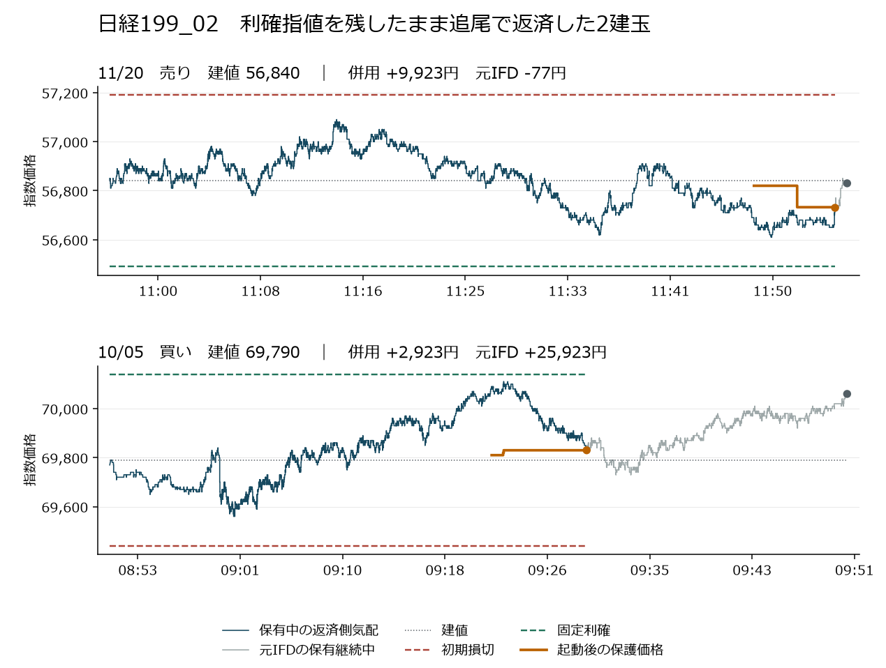

# 220　日経199_02はどこで損切りし、どこで利益を確定するか

2026-11-22。日経199_02デイの入口を使う場合、**初期損切は元の片幅を基本にし、午後の往復相場でだけ少し広げる。利確指値を先に置き、届く前に反転した利益を追尾で守る**方法を主候補とした（B400P3）。初期損切に400ptの上限を設けると、この45日では元の最大1件損失41,077円を保ち、費用後収支が182,000円増え、損失総額が126,462円減った。[日別・建玉別CSV](../../outputs/00220_日経199デイの損切と利確/README.md) ・ [全条件](全条件の比較.md)

## 建てたら置く注文

1. **最初の損切り**　元の入口が新規時に指定した片幅をRとする。買いは建値からR下、売りはR上に非常用の損切を置く。11:30以降の新規で、直近12分の値動きが往復している場合だけ1.10Rに広げ、いずれも400ptを上限とする。往復の判定は、完成した13本の1分終値について「最初から最後までの変化の絶対値÷各変化の絶対値の合計」が0.35以下。足がそろうまでは通常幅。初期幅は取得時に確定する。
2. **利確指値**　12:30より前に建てたら順行1R、12:30以降に建てたら0.90Rに全量の利確指値を置く。保有中に12:30をまたいでも最初の指値を維持する。
3. **指値に未到達の利益を保護**　分単位の期限の建玉は0.85R、場末期限の建玉は0.95R順行したら必ず追尾する。返済要求まで残り10分以内なら、現在の順行が0.45Rに達した時点でも起動する。順行幅は買いでは返済可能なBid、売りではAskで評価する。通常は「建値より20pt有利な価格」と「最大順行から0.80R戻った価格」のうち、利益を多く残す方を保護水準にする。
4. **期限前に勢いが弱まった場合**　最後の10分に、完成1分足のEMA3とEMA8の差が順行に不利な方へ変化し、直近3分の方向効率が0以下になったら、追尾幅を0.35Rに縮める。直近8終値の標準偏差が3分前の75%以下で、終値がEMA3の逆側にある場合も同じ。引き上げた床は緩めない。利確指値・初期損切・保護返済・期限のうち先に成立した決済で1枚全量を閉じる。[板での注文優先と期限](../00219_日経199デイの利益保護と出口条件を比較する/口座再生の仕様.md)

|元入口のR|通常の損切幅|午後の往復時の損切幅|12:30前の利確幅|12:30以降の利確幅|
|---:|---:|---:|---:|---:|
|150pt|150|165|150|135|
|200pt|200|220|200|180|
|350pt|350|385|350|315|
|400pt|400|400|400|360|

Rは元の順行・反転・補完の注文に保存されている。元の181建玉はR350が114件、R150が31件、R400が24件、R200が12件で、R400は全件場末期限、他はすべて60分期限だった。例えば13時に60,000でR350の買いを建てた場合、通常の損切価格は59,650、往復条件が成立していれば59,615、固定利確は60,315。通常期限なら297.5pt順行、または残り10分で157.5pt順行から保護する。最大順行が300ptなら初期の保護価格は60,020、期限前に失速が成立すると60,177.5まで上がる。これらは判定閾値であり、正常な板が届いた価格と次の返済価格は、呼値や値飛びで異なり得る。日経225miniの呼値は5pt、今回のラージ板は10pt。[JPX商品概要、2026-11-22確認](https://www.jpx.co.jp/derivatives/products/domestic/225mini/index.html)

## 利確指値とトレールはどちらが効いたか

日経ラージの過去板でmini 1枚を約定代用。全45デイ（2026-09-21〜11-20）、期限最長15:30、保有・予約は買売合計1枚。片道手数料38.5円と追加滑り5pt、往復1,077円を引いた円額。表の全候補が45日すべてに参加し、損益不明0件。日末最大下落額は、日末累計のそれまでの最高額からの最大下落。

|損切|利確条件|建玉|利益|損失|収支|日末最大下落額|赤字日|
|---|---|---:|---:|---:|---:|---:|---:|
|元1R|元の固定1R（IFD）|181|2,362,530|1,342,467|+1,020,063|147,463|12|
|上記400pt上限|元の固定1R（B400P0）|179|2,371,530|1,247,313|+1,124,217|75,386|12|
|同じ|12:30以降だけ0.90R指値（B400P1）|181|2,420,299|1,226,236|+1,194,063|75,386|12|
|同じ|**その指値＋可変追尾（B400P3）**|**181**|**2,418,068**|**1,216,005**|**+1,202,063**|**70,386**|**12**|
|同じ|指値なし、同じ可変追尾（B400P4）|160|2,246,146|1,148,466|+1,097,680|102,309|11|
|同じ|1.50R指値、1R到達後は最低0.80Rを守る段階追尾（B400P6）|174|2,431,453|1,221,851|+1,209,602|66,694|13|

**追尾を加えた増分**は、同じ損切・同じ利確指値のB400P1に対し、総損失10,231円減、収支8,000円増だった。B400P3の182,000円の改善には、初期損切の変更と午後の利確幅短縮も大きく寄与した。B400P3では101件で追尾が起動し、実際に追尾で返済したのは12件。固定利確68件、初期損切27件、通常期限68件、場末6件だった。利益を一度経験して赤字で終わった建玉は元55件から51件、その損失は891,235円から836,927円へ減った。

**総損失の最小化を強く優先するならB400P4にも意味がある。** 指値を外すと、同じ181建玉だけではB400P3より収支が15,000円高く、損失は同額だった。1枚口座では保有率が50.98%から56.65%に上がり、後続の取得が変わる。結果は指値ありより総損失67,539円減、収支104,383円減、赤字日1日減、日末最大下落31,923円増。B400P6なら主案より収支が7,539円増えたが、総損失は5,846円多く赤字日も1日増えた。もっと早く0.50Rを丸ごと守る案では、元181建玉に固定すると主案より収支が34,000円減った。[利確条件だけを変えた追試](利確の追試/README.md)

## この損切ラインを選んだ理由

- 元IFDの保有中に0.75Rまで逆行した55件のうち、14件は元の決済では黒字だった。0.75Rで一律に切ると、同じ181建玉で総損失が228,078円増え、収支が421,000円減った。0.95R逆行した30件はすべて元の決済が赤字だったが、0.95R損切と1R利確にすると、固定181件では＋27,000円、後続を含む口座では元より−13,000円。狭めてよい位置は5ptの丸めにも敏感だった。[逆行からの回復](経路診断/README.md) ・ [境界の28案](経路診断/境界の結果.md)
- 同じ利確を用いて全取引の損切を100ptにそろえると、最大1件損失は20,077円まで下がったが、256建玉、総損失1,724,320円、収支＋344,288円、赤字23日に悪化した。直前の安値・高値の外に半ATRを足す方式も検証した。構造水準をそのまま使えた9件では、元の幅に置いた対照と決済が一致した。[構造ストップの検証](構造ストップ/README.md)
- 400pt上限を外してW31の幅をそのまま採ると、収支はさらに8,077円高く、総損失も8,077円少なかった。一方、最大1件損失が41,077円から45,077円に拡大した。上限を350ptまで狭める候補は最大36,077円、収支＋1,154,832円、総損失1,294,082円。今回は1件の最大損失を旧水準に保ちつつ損失総額を抑えることを優先した。[初期損切と利確の交差比較](主比較/README.md)

## 同じ取得から異なる利益になった実例

- **9月29日14:19、65,220で売り。** 午後の固定利確幅315ptが先に届き、14:37に64,900で返済し＋30,923円。指値を外して追尾した場合は14:57に65,170で返して＋3,923円、元IFDは期限で−21,077円だった。この建玉を救ったのは午後の利確指値だった。
- **11月20日10:56、56,840で売り。** R350、初期損切57,190、固定利確56,490。11:48に残り時間の条件で保護を起動し、11:55:05に56,730で返して＋9,923円。元IFDは11:56:04に56,830で返し、費用後は−77円だった。逆に10月5日08:51の69,790買いでは、同じ保護で＋2,923円を確定した後に価格が回復し、元の期限返済は＋25,923円だった。[2日分のViewer](Viewer/README.md)

## 期間差と次の検証

主案の前24日は損失400,617円・収支＋688,994円、後21日は損失815,388円・収支＋513,069円。元IFDの各期間は損失462,925円／879,542円、収支＋595,917円／＋424,146円。直近3日の収支は元−37,463円に対し主案＋614円。10月20日を除いても＋1,030,448円、最も改善した3日を除いた同じ日集合での元との差は＋42,923円。どの1暦週を除いた40日でも損失減・収支増が残った。主案の建玉／セッション収支中央値は＋12,923円／＋27,615円、買い収支＋324,302円・売り＋877,761円。

元と同じ181取得に固定した主案の収支は＋1,120,063円（元比＋100,000円）。1枚口座で新旧両方が取得した170件の決済差は＋80,000円。元だけの11件は−16,847円、新口座だけの11件は＋85,153円で、入れ替わりの寄与は＋102,000円だった。45日のうち日次が元より改善したのは11日、悪化13日、同額21日。利益保護の額が毎日積み上がったわけではない。

元IFDと128設定を比較した。同じ決済になった対照を含み、すべて既使用の45日である。ポイント幅群の前24日選抜首位は一律300ptのA300P3で、後21日の収支は＋280,838円まで落ち、元の＋424,146円を下回った。B400P3は全期の損失、収支、最大1件損失のバランスから選んだ研究候補である。追加デイでは元IFD・B400P3・B400P4・上限なしS3P3を同じ1枠で固定再生する。ラージ板とmini個別の流動性、気配を飛び越える約定、費用と遅延には差が残る。[比較方針](比較方針.md) ・ [設定と結果](設定と結果.md) ・ [再現手順](再現手順.md)
