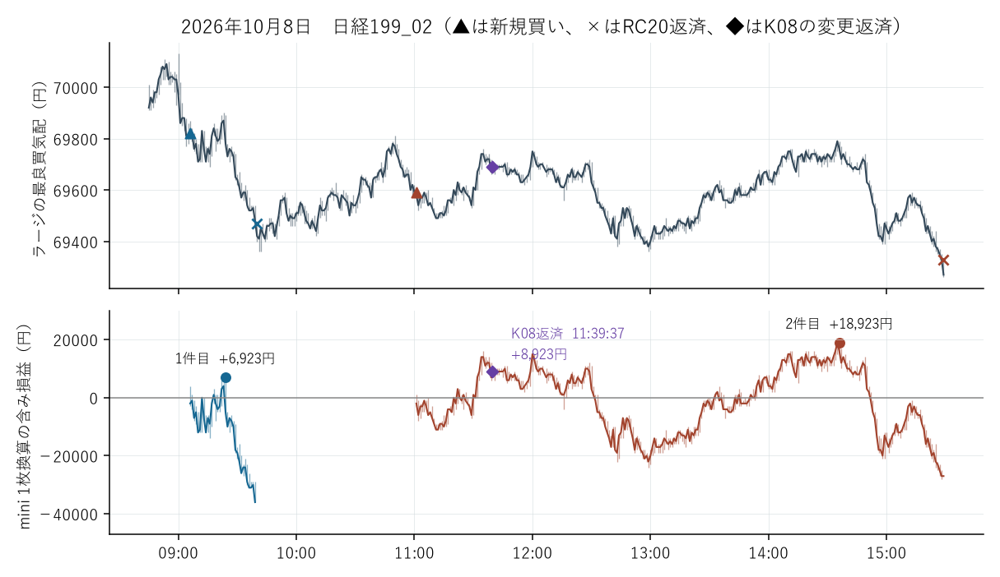

# 10月8日はなぜ利益を確定できなかったか

RC20は買い2件、売り0件、利益0円・損失63,154円。既使用45デイで最も赤字が大きい。2件とも反発して費用を超える含み益が生じた。朝の反発は追尾を始める最小幅に届かず、昼の反発は値幅が足りたものの、追尾を開始するための売りシグナルが連続しなかった。2件目には実際に当時の気配で利益を残せた出口がある。



上段は最良買気配の各分の高安と最終値。新規買いは最良売気配で取得するため、印が買気配線より上に出ることがある。下段はRC20の保有中の清算側評価額で、紫の印以降も続く赤線はRC20が実際に保有していた経路。SessionTradeViewerで一覧を開くと、2候補の全約定と建玉を原板に重ねて切り替えられる。各4約定片、日次収支と最終残数を配布版の数値APIで照合した。[Viewerの一覧](Viewer/一覧.resources.json)・[配布版での検算](Viewer/配布版での検算.json)

## 買った時に分かっていたこと

2件とも旧BO0065の下抜けを反転させた買い。元の判定は直近3分の価格端突破、5分足の実体、MACD・RSIの変化、相対出来高で下方向の動きを検出する。199_02では、反転買いを保留するリスク条件R1が成立した場合に改めて反発を確認する。両時刻とも5分EMA21と短期の勢いは悪化したが、5分DI差（＋DI−−DI）はまだ買い優勢だった。R1には元の下方向とDI差の一致が必要なので保留が掛からず、買いへの構造回復がなくても旧条件から直接発注できた。199_00の底本で両件とも旧BOが成立、旧MPは不成立、199_02で新規追加・保留・反転確認・順行確認は全て無。補完入口からの注文は0件。[旧BOの仕様](../../../docs/議論/十一月十六日の最大損失と反転確認の不足.md)・[199の固定入口](../../00199_保留中の旧幹を確認済みの根拠で切り替える/README.md)

|当時の値（買い側）|09:06:00の判断|11:01:00の判断|
|---|---:|---:|
|5分EMA21の前足差|−6.63pt|−2.63pt|
|15分 / 30分EMA21の前足差|＋20.79pt / 履歴不足|−7.99 / −11.56pt|
|5分MACDヒストグラムの前足差|−13.76|−5.69|
|5分RSIの前足差|−24.31|−3.04|
|5分DI差|＋2.25|＋5.70|
|5分の真の値幅÷同足のATR|4.73倍|1.11倍|
|1分出来高÷直前3分平均|1.06倍|1.21倍|
|直前3分の安値を0、高値を1とした取得側気配の位置|−0.105|−0.111|

朝は5分足が大きく下へ動いた直後で、15分EMAの上向きが残っていた。昼は5・15・30分のEMAがすべて下向きだった。反発を狙うという発想は共通でも、二つを同じ地合いとして除外する根拠はない。また、下落・片道に分類された9日のうち赤字はこの1日だけで、他の日には売りが利益に寄与した。[全45日の形別検証](../日別の形/README.md)

## 最大順行と実際の決済

日経225mini 1枚換算、1pt=100円。ラージの正常Bid・Askを使う。買いの含み損益は各行のBidで評価し、往復手数料77円と追加滑りの仮定1,000円を控除。各時刻は日本時間、極値は取得から実際の決済までの初回到達。2件とも初期IFDの片幅は350pt。

|買い|取得|最初の費用後黒字|最大順行・時刻|最大逆行・時刻|決済|最大含み益からの減少|
|---|---|---|---|---|---|---:|
|朝|09:06:02　69,820|09:06:03|＋80pt、＋6,923円　09:23:49|−350pt、−36,077円　09:39:51|09:39:51　69,470、固定逆指値　−36,077円|43,000円|
|昼|11:01:02　69,590|11:01:15|＋200pt、＋18,923円　14:35:58|−270pt、−28,077円　15:28:33|15:29:01　69,330、場末返済　−27,077円|46,000円|

朝は最大80pt＝0.229Rで、RC20の弱い方の起動条件0.25R＝87.5ptにも届かなかった。ピークから41秒後の09:24:30には費用後ゼロ以下に戻った。昼は0.571Rに達したが、無条件の0.95R追尾にも、W12の0.80R順行条件にも届かなかった。ピークから16分10秒後の14:52:08には費用後ゼロ以下になった。引用したピークは保有経路の診断値で、そこで決済できたと仮定した収支は加えていない。

## 下落を示す主入口があった時の保有状態

09:05以降、新規判断331時点のうち、有効な主入口は8回。09:06と11:01の買いを取得し、残り6回（買い4・売り2）はすべて昼の買いの保有中だった。朝の損切りから11:01までに主入口は0回。初参加用の補完信号は56回出ているが、2回は主入口が優先、54回は既に当日取得済みで、追加の発注にはならない。

|判断時刻|主入口|この時点の処理|
|---|---|---|
|09:06:00 / 11:01:00|買い / 買い|各1枚を取得|
|11:03:05 / 11:12:12|買い / 買い|保有で追加不可|
|11:36:01|売り|保有で新規不可。単発の反対示唆として観測できた|
|12:36:11 / 12:40:00|買い / 買い|保有で追加不可|
|13:56:00|売り|保有で新規不可。前回売りとの間に買いが2回|

RC20で反対示唆から追尾を狭めるには、直近2回がともに反対側で、最新90秒・その前180秒以内であることを求める。売り2回は離れており、連続条件を満たさない。保有中の売り2件の仮想収支を損益に含めていない。

## 同じ二建玉でどこを変えると利益が残ったか

|出口|朝の確定損益|昼の決済時刻・確定損益|10月8日の収支|既使用45日収支|
|---|---:|---|---:|---:|
|単純IFD（I20）|−36,077円|15:29:01　−27,077円|−63,154円|＋968,759円|
|RC20|−36,077円|15:29:01　−27,077円|−63,154円|＋1,006,759円|
|W12　0.80R後の転換で追尾|−36,077円|15:29:01　−27,077円|−63,154円|＋1,014,759円|
|W01　反対主入口1回で返済|−36,077円|11:36:10　＋12,923円|−23,154円|＋708,759円|
|D01　出来高低下で返済|−36,077円|11:40:10　＋7,923円|−28,154円|＋189,759円|
|K08　寄り・5分・15分が逆向きの取得に限り、反対主入口1回から追尾|−36,077円|11:39:37　＋8,923円|−27,154円|＋1,034,759円|

W01の当日改善40,000円に対し、全45日の収支はRC20より298,000円少ない。D01も全体では817,000円少ない。K08は二件目で11:36:01に追尾を起動、11:39:36に発動、次の11:39:37の正常なBid 69,690で返済した。単発反対でも取得時の背景を絞ることで当日36,000円を救ったが、残り44日の合計差は−8,000円。他の日も改善できるかは、同日を外した各候補・入口変更と出口変更の比較で判断する。[出口の設定](../出口/条件.md)

## 利益が1件も確定しなかった他の日

全45デイの赤字11日のうち、黒字建玉を含む日は6日、利益0円で損失だけの日は次の5日だった。5日6建玉は全件が費用後に一度は黒字で、5件は場末まで残った。各場末決済の最大含み益は2,923〜19,923円と幅がある。黒字を通った赤字は全133建玉中33件、全赤字42件中33件で、損失だけの日に限られる現象ではない。

|日付|方向・件数|最大含み益（建玉別）|場の費用後収支|決済理由|
|---|---|---|---:|---|
|09/23|売1|＋2,923円|−23,077円|場末|
|10/05|売1|＋17,923円|−19,077円|場末|
|10/08|買2|＋6,923円、＋18,923円|−63,154円|固定損切、場末|
|10/12|買1|＋19,923円|−8,077円|場末|
|10/28|売1|＋13,923円|−1,077円|場末。取得と同じ気配価格に戻り、往復費用分が赤字|

## 再現

2026-11-23確認。親試行の再現手順で199の旧73場の純成立診断、222・224・227・228出口の元帳を用意する。下記は当時特徴・原板索引・予約を再突合し、画像・Viewer一覧・2候補の約定を再生成する。配布版APIの全片検算を再実行する場合は起動済みViewerのURLを `--api` に指定する。[再現コード](建玉を照合する.py)

```powershell
python -X utf8 (Get-Item 'study/00228*/十月八日/建玉を照合する.py').FullName
```
